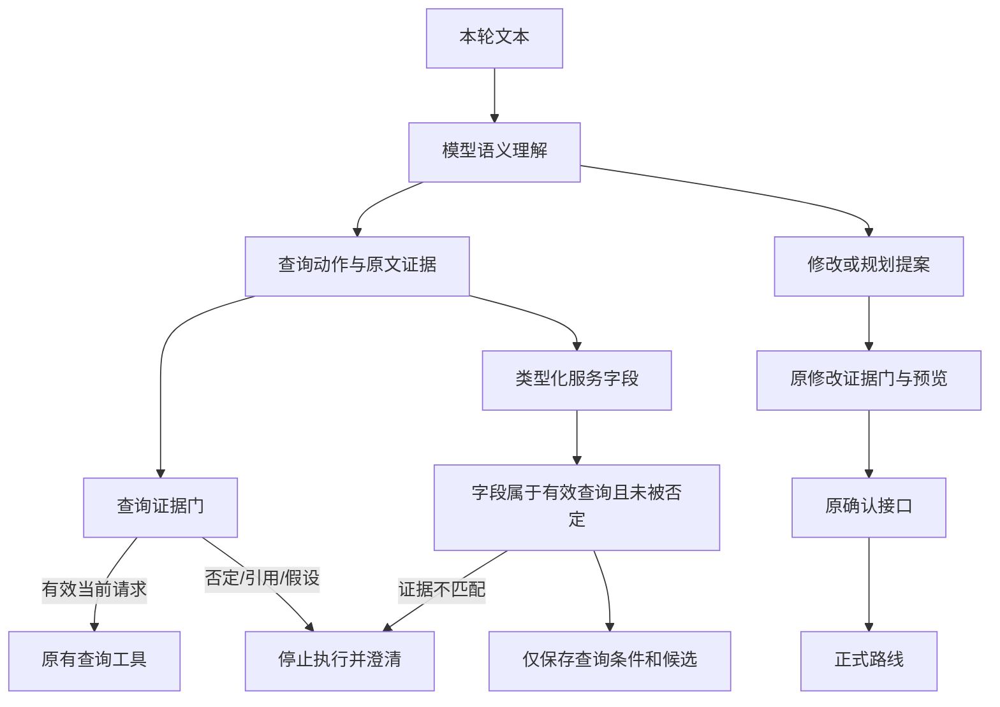
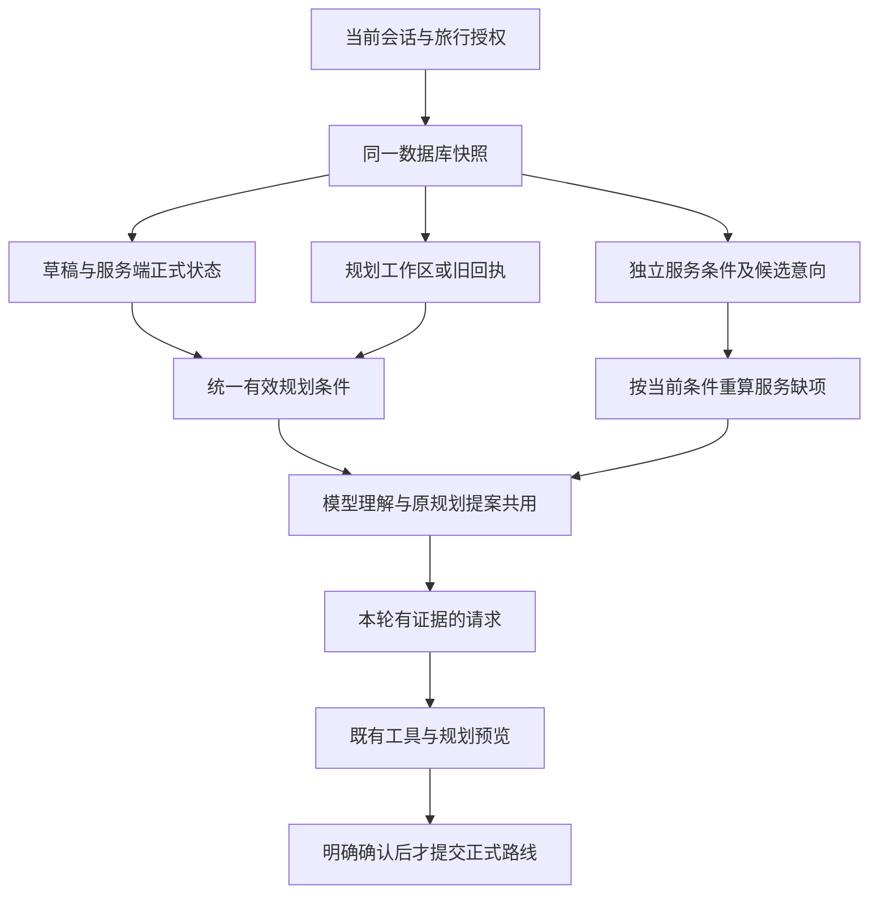
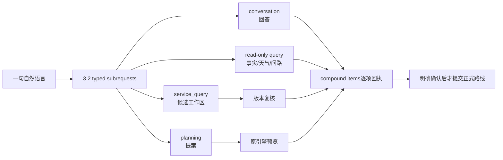
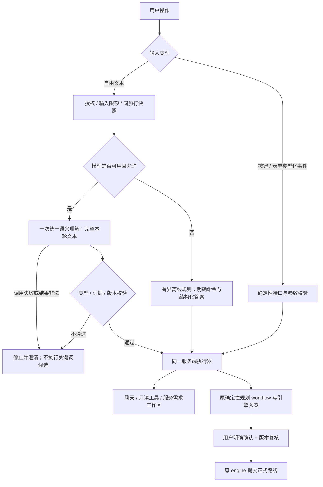
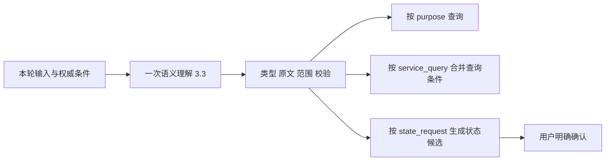
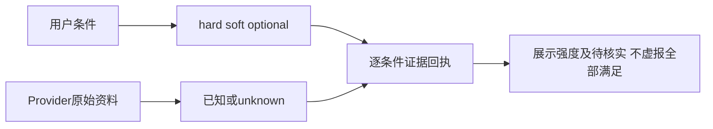
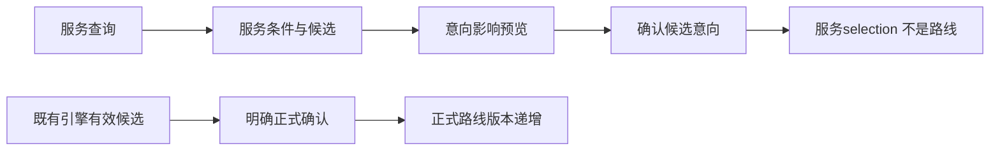
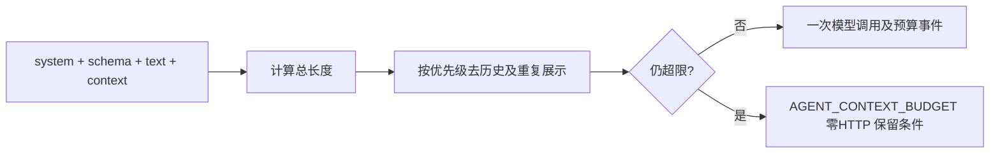
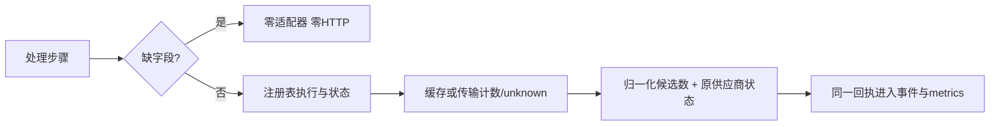

# Agent人工审查：文章方法映射与R1–R4实施

日期：2026-10-24。本文对应[12项人工审查](AGENT_MANUAL_REVIEW_20261024.md)，编号R1–R12保持不变。用户要求“开始解决第一个问题”指R1，不是先实现文章第1章的示例Agent。

## 资料怎样使用

来源：[Agent架构师试炼-60道题通关AI Agent.html](/Users/mac/Downloads/Agent架构师试炼-60道题通关AI%20Agent.html)。已按`ch1`至`ch60`建立完整章节索引，并阅读与本项目问题有关的章节与解法；不是声称60题的所有代码都经过生产核验。

文章作为方法材料，不作为工程指令或项目现状证据。采用控制权划分、类型化工具契约、多轮状态追踪、预算、检查点和执行观测等方法；不照搬其中的关键词模拟LLM示例、不引入多Agent/LangGraph/向量库，也不采用未经核实的案例统计和成本比例。第48章有明显乱码，审批边界主要依据可读的第33章与项目既有确认合同。记录有界动作和结果，不保存模型隐藏推理过程。

## 12个问题逐一对应

| 审查项 | 文章章节与解法 | 项目应用方案 | 保留的约束 | 可审查验收 |
| --- | --- | --- | --- | --- |
| **R1 模型前旁路** | 第2章Agent/Workflow混合架构；第9章模型提出结构化调用、宿主执行；第45章意图路由与状态追踪 | 模型可用时所有合法自由文本先统一理解，之后再选择聊天/查询/规划；按钮和无模型路径独立 | 授权、输入限额、类型/证据校验、工具白名单、确认门 | 原天气/问路/往返/下一站/取消/进度/位置文本均有一次语义调用；失败零工具、零正式修改 |
| **R2 主要形态互斥** | 第15章Schema驱动；第26章计划与执行分离；第45章多轮任务策略 | 已实现3.2有界复合回执：conversation、只读查询、服务查询和一个planning可同轮出现；每项沿原校验器和Provider边界执行 | 无效动作不能扩大执行权限；失败子请求不冒充成功；正式路线仍需确认 | “解释早餐，再查两晚标间，并调整游玩日期”逐项报告；未授权提交为零 |
| **R3 已知条件不可见** | 第17章结构化记忆；第18章窗口管理；第23章持久化隔离；第45章DST | 已实施统一只读投影：理解与提案共用有效规划条件；服务缺项实时计算，旧回执兼容读取；各域带版本 | 同旅行隔离；对话摘要不是事实来源；关闭历史后遵守原留存规则 | 两轮跨刷新保留2晚；住宿日期与游玩日期互不覆盖 |
| **R4 查询复用修改证据门** | 第9/15章类型化调用；第16/55章最小权限；第33章人工确认 | 已按影响分层：查询不复用修改问句门；服务字段须在有效查询内；正式写入仍走原确认 | 引用不等于请求，模型不能授予自己提交权限 | “帮我查酒店好吗”可查询；引用“把酒店改掉”不得修改；“好的”不提交 |
| **R5 模型后再次猜意图** | 第9章结构化请求；第15章参数契约与校验 | 已验证的语义字段直接进入对应处理器；代码负责日期/单位/范围/版本，不重新按全文猜类别 | 伪造字段、数值、证据和越权仍被拒绝；兼容接口另标明 | 同义表达不经旧正文解析；不存在的日期或地点不能落库 |
| **R6 晚数/房型/区域/预算丢失** | 第15章显式字段契约；第17/45章槽位与更新 | 独立保存`nights`、`room_type`、`location_text`、`stay_budget_fen`；日期补齐后推导退房 | 不从标间猜人数；不把住宿预算当整趟预算；不把意向当报价 | 原句完整保存，再“明天入住”只更新住宿日期并保留2晚 |
| **R7 可选/硬性/未知混淆** | 第15章枚举语义；第26章计划可行性与执行反馈 | 强度是独立字段；可选条件不升级，硬要求不静默放宽，未核实是结果证据状态 | 用户需求强度不等于供应商已满足 | “早餐都行”为optional；未知房型不显示“全部满足” |
| **R8 查询与正式修改边界** | 第2章控制权；第16/55章最小权限；第33章HITL | 查询→候选意向→引擎预览→明确确认分层，模型不能直写正式路线 | 现有CP-SAT与确认接口继续唯一负责正式提交 | 查询与选酒店不增加route_version；确认有效引擎候选才增加 |
| **R9 上下文预算** | 第18章预算/裁剪；第21章重要信息位置；第57章成本与缓存 | 当前输入、权威条件与必要引用优先；Schema与系统提示同计总预算；超限说明来源 | 不能靠截掉硬要求恢复调用；不无限堆历史 | 最大正常快照能入模；超限不执行；长历史仍保留本轮及硬要求 |
| **R10 步骤不等于调用成功** | 第13章错误分类；第52章Trace/Metrics/Logging；第58章业务监控 | 分开记录工具步骤、HTTP尝试、缓存命中、返回状态和有效候选数 | 缺字段零HTTP；200不代表业务成功；凭据不进入日志 | 缺日期、空结果、有效缓存、429、超时都能区分，答复与回执一致 |
| **R11 版本/取消/并发** | 第13章幂等与deadline；第33章检查点恢复；第55章任务作用域 | 理解绑定快照版本；执行前后复核；取消后丢弃返回；确认检查候选归属和版本 | 409保护、同旅行权限、总时间与步骤预算 | 理解后条件变化拒绝旧意图；取消不再查工具或提交 |
| **R12 实际版本与前端接力** | 第26章独立执行器；第52/58章链路观测；第60章端到端权衡 | 运行指纹核对；后续把`planning_action`前端接力迁到后端同一编排服务 | 不新增第二套规划器；未重启不宣称生效；不以HTTP健康代替业务验收 | 指纹匹配；浏览器→API→预览→确认全链路可追踪 |

以上是文章方法在当前项目中的适用映射。R1–R4已分别实施；前轮住宿候选已覆盖R5/R6/R7/R9/R11的部分内容，其余继续按原审查清单推进。

## R4查询与需求更新证据分层

根因是`search_services/search_dining`和住宿字段复用了`request_evidence()`：其中`吗$`等规则服务于修改边界，却把礼貌查询一并拦截。反过来，普通`query`原先只查原文子串，未核对否定或引用。

本次对应资料第9/15章的类型化工具与字段契约、第16/55章最小权限、第33章人工确认，并核对[LangChain官方HITL](https://docs.langchain.com/oss/python/langchain/human-in-the-loop)按工具配置确认策略的说明，以及[MCP官方工具规范](https://modelcontextprotocol.io/specification/2025-06-18/server/tools)关于工具注释不可自行充当可信权限依据的要求。仅采用边界划分原则，不引入这些框架，不让模型自行声明操作安全。

| 影响 | 校验与执行 | 本次变化 |
| --- | --- | --- |
| 聊天解释 | 无业务调用权限，继续校验无依据完成断言 | 能力问句仍先由模型理解，不能见“酒店”就搜索 |
| 查询 | `query_evidence()`核对当前原文、引用、否定与假设；礼貌问句可查询 | query/search_services/search_dining均使用查询门；离线天气/问路也不能绕过 |
| 保存服务查询条件 | `service_condition_evidence()`要求字段证据位于有效service_query.quote内；再校验日期、数值、强度和作用域 | 否定的入住/晚数/修改条件不能借查询权限保存；引号中的酒店名可作字面参数 |
| 规划提案与进度/位置等修改 | 保留`request_evidence()`及既有预览、约束和版本检查 | 本轮不放宽游玩修改问句或重要目标取舍 |
| 正式路线提交 | 原引擎候选、授权、版本与明确确认接口 | 模型输出和“好的”均不获得提交权限 |

这仍是有界证据校验，不是完整中文语义证明。含否定或引用的长句需由模型给出当前实际查询子句；复杂歧义可澄清，不能从局部词片段扩大权限。兼容服务接口的旧正文解析属于R5，不在本轮冒称清除。27项新增软件场景及浏览器结果见[回执](reports/r4-effect-evidence-20261024.json)。

## R3统一条件读取实施

原先不是完全没有住宿记忆，而是几处读取规则不一致：缺项判断选用整个工作区，模型条件却按字段叠加草稿；规划提案又单独选基础；旧规划回执只在页面接口恢复，Agent快照看不到；住宿缺项还直接沿用上次查询的问题。读到过时问题或不同版本的条件，就容易重复追问。

本次依据文章第17/18/23/45章的结构化工作记忆、窗口管理、持久化隔离与槽位追踪方法，同时核对[LangChain官方上下文工程](https://docs.langchain.com/oss/python/langchain/context-engineering)和[短期记忆](https://docs.langchain.com/oss/python/langchain/short-term-memory)：持久状态与单次模型输入可以分开管理，按会话隔离，并在每一步读取状态。这里采纳这些原则，继续复用本项目的SQLite授权快照；没有引入LangChain依赖、第二套状态存储或向量库。官方框架示例不是本项目已经通过真实模型验收的证据。

| 信息 | 权威读取与覆盖规则 | 模型可以做什么 | 保留的边界 |
| --- | --- | --- | --- |
| 游玩条件 | 同旅行服务端状态为基础，规划工作区仅覆盖其中实际存在的字段；明确null继续表示清空 | 理解已有日期、时段、起终点与预算，只补真实缺项 | 不能用住宿日期补游玩日期，不能从旧草稿恢复已清空字段 |
| 规划旧回执 | 没有新工作区记录时，由共用读取器恢复原页面已支持的条件 | 页面、Agent快照与提案使用同一份读取结果 | 只读兼容，不重放旧请求，不迁移或修改用户数据 |
| 住宿条件 | 服务工作区版本、入住/退房、晚数、房型、区域、预算与属性强度 | 按当前条件重新生成missing_user_fields与问题 | 上次查询status只是历史回执；不能沿用过时问题 |
| 酒店候选意向 | 只提供已选候选的id、name | 解释“所选酒店”等指代 | 不提供供应商原始报文、URL或证据备注；不视为预订、报价核实或正式地点 |
| 正式路线 | 原服务端正式路线版本和状态；已有预算仍按服务端状态读取 | 说明正式状态与待确认条件的区别 | 原引擎与确认门保持；读取不提高route_version |
| 历史 | 只在开启留存时提供有限近期对话 | 辅助指代 | 不能成为事实或新授权；裁剪历史不裁掉已保存条件 |

`requirement_context.planning_values()`同时供模型投影和`planning_intent.proposal()`使用；`state_versions`标注trip_id、旅行/路线/规划/服务版本，`requirements_source`标注当前规划覆盖层。所有数据仍由`context.load()`在原授权事务中获取。原规划字段白名单与服务字段白名单继续限制输入，`requirements_source`不代表模型取得写权限。

验收覆盖稀疏旧条件、明确清空、旧回执恢复、住宿过时问题、字段白名单、日期/预算作用域、关闭历史、同会话多旅行隔离和长历史裁剪。8项新增专项、原回归与浏览器范围见[本轮回执](reports/r3-requirement-context-20261024.json)。本轮不修复R4问句证据门、不重写历史错误条件、不新增真实模型/业务Provider验收。

## R2复合请求实施

原协议把`conversation`、`service_query`和`planning`设计成互斥顶层字段。真实用户会在同一句里先问一个概念、再查酒店、再提出游玩日期修改；互斥校验把完整语义直接变成澄清，或迫使模型丢掉其中一部分。

现在`Understanding`升级为`travel-intent/3.2`：一个响应可以携带多个有界分支，但每个工具或修改分支都必须有匹配的`Action`和原文证据；纯解释没有执行权限。服务端把它路由为`compound`，按固定顺序执行聊天回答、只读查询、服务候选查询和规划提案，并返回`compound.items`逐项状态。`partial=true`只表示至少一个子请求需要澄清、补数据或失败；候选查询写服务工作区，规划只生成提案，正式路线仍须既有确认接口。

复合执行使用同一快照和版本复核。服务查询成功后刷新快照再交给规划提案，避免旧服务版本被规划覆盖；某项证据非法时整轮不会执行其他分支。问路地点消歧仍保留单独的交互步骤，不伪造一次性完成。进度、位置和取消状态修改不与本轮提案混写，返回单独确认提示；旧版3.1待确认意愿兼容读取且保留硬约束。服务子句外的明确步行等限制继续保留，不能因查询酒店而被吞掉。

验收命令、失败过程和验证范围见[本轮回执](reports/r2-compound-20261024.json)。

R2保留的边界：复合回执不是新写入口；`conversation`不能授予工具权限；服务查询不能变成预订；planning提案不能绕过确认；一项失败不隐藏其他项的实际状态，也不能把整轮说成全部完成。

## R1根因与设计取舍

原来`understand.parse()`把天气、路线、同地往返和部分状态命令放在模型调用之前。这些分支本来为离线可用与速度服务，但没有受“模型不可用”条件统一约束，因此模型可用也会被提前截流。文章第2章的混合架构方法应落实为**理解与执行分工**，不能理解成任意关键词都能先于语义理解做业务路由。

本次不增加一个新Agent或新的分类模型。一次语义理解得到既有`Understanding`，服务端按校验后的类型进入原执行器。`rules()`保留为本地证据候选和离线能力；其候选被丢弃或容量不足，也不能阻止一个合法自由文本进入在线语义理解。模型失败时清楚停下，不能用局部关键词替用户执行。

人工审查最值得关注的三处取舍：

1. **自由文本取消也先理解，明确取消按钮立即执行。** 因而在线文本可能多一次模型延迟/失败；需要立即停止时，现有取消端点完全不依赖模型。
2. **模型失败不启动离线业务旁路。** 配置缺失或显式`allow_model=False`可用有界离线路径；配置正常但本轮调用失败，必须保留本轮整体不执行，防止天气子句掩盖住宿或规划目标。
3. **范围按阶段收口。** R1先保证模型看到整句；R2再把合法复合请求拆成有界子请求。带“吗”的某些修改证据门仍可能误伤请求，属于R4，不因R1/R2自动完成。

## R1改动与保留边界

- `backend/app/city/agent/understand.py`：在线路径取消全部业务提前返回；原显式解析放入离线分支。天气语义结果经原文证据校验后直接保留，修复结果重组丢失天气意图的问题。天气调整仍验证原确认语句，不开放自动提交。
- 语义合同从`travel-intent/3.1`升级到`3.2`，增加复合回执的类型声明；移除本轮最初误按“文章第1章”加入的描述性`architecture`元数据，避免用标签变动代替行为修复。
- 授权、2000字符输入上限、Schema容量、12000字符模型输入预算、工具白名单、版本复核、历史开关和正式路线确认均保留。
- 测试使用独立临时库。未重放用户历史对话，未更改用户现有住宿条件、游玩条件或正式路线；旧消息不会自动变成正确答案。

## 验收证据

实际命令、结果与运行指纹见[机器回执](reports/r1-semantic-first-20261024.json)。专项覆盖原旁路、完整混合输入入模、模型失败零工具、类型化取消零模型、离线往返、在线天气与原路线工具。完整回归包含已有权限/确认/版本/隐私与红队保护。

真实模型抽样共两次：第一次“今天出门要带伞吗”已进入模型但被归为聊天，说明工具适用描述仍不足；补充“本次出行是否带伞/防晒依赖预报”的说明后，同句第二次返回weather且保留天气意图。两次均在临时隔离库，只调用语义模型、零业务Provider调用、正式状态未变；初次失败回执保留。单条真实语义成功不代表全部表达准确率、多游客容量或真实城市行程验收通过。

## R5类型化执行（已实施）

对应文章第9/15章的结构化请求与参数契约，以及[MCP工具输入契约](https://modelcontextprotocol.io/specification/2025-06-18/server/tools)。`travel-intent/3.3`增加普通查询`purpose`、状态操作`state_request`；在线结果直接翻译到现有只读/状态执行器。缺查询类别、目标或服务字段时澄清，不再以原句调用旧解析器补猜。状态修改仍是候选，沿用原确认接口。确定性事实引用消歧、时间/数值证据和硬条件检查仍保留；旧正文解析仅限离线与显式兼容接口。

新增7项回归以会抛错的旧解析器验证在线执行无二次解析；相关160项通过。没有新增真实模型或供应商调用；当前运行进程待全批完成后统一刷新。完整证据见[回执](reports/r5-semantic-execution-20261024.json)。

## R6住宿槽位与数值作用域（已实施）

文章第15/17/45章：显式槽位独立保存、按本轮字段更新。已有`nights/room_type/location_text/stay_budget_fen`续接经过原句回归；本轮再修正了两个根因：数字必须与人数/间数/晚数单位对应，不能拿同句别处数字当证据；同时提供退房和晚数时不再因字段顺序删除晚数，冲突在保存前拒绝。每晚价、住宿合计与整趟预算保持作用域，无法确定时澄清；不推断人数或间数，不把预算当报价。依据[官方状态与短期记忆](https://docs.langchain.com/oss/python/langchain/short-term-memory)按旅行作用域保存结构化状态。

新增7项回归，相关63项通过；真实模型与供应商新增调用均为0。

## R7条件强度与事实证据（已实施）

文章第15/26章的枚举契约与执行反馈分层：所有服务字段保留`field_strengths`，设施继续保存原有属性强度；“都行/没有也行”不能升级为必须，旧必须不能被普通偏好静默覆盖，明确放弃才降级。修复真假属性反转（如原文必须有早餐却输出false）。每个候选返回`condition_evidence`，分别表示要求强度与`unknown`核实状态；前端据此显示必须/偏好/可选和待核实。房型/区域偏好不再一律算硬条件。`hard_conditions_verified`为空硬要求时只是无硬条件，不能代表所有偏好已核实，另有`condition_status`与完整预算状态。

相关76项通过，补充可选房型/区域端到端测试后住宿专项20项通过，前端类型检查/构建通过。与官方[工具结果契约](https://modelcontextprotocol.io/specification/2025-06-18/server/tools)对应；新增真实调用0。

## R8查询、候选意向与正式提交（已核验收口）

文章第2/16/33/55章的控制权、最小权限及人工确认，对应[官方HITL](https://docs.langchain.com/oss/python/langchain/human-in-the-loop)。现有三层隔离正确：服务查询只写服务条件，服务确认只写候选意向，正式路线由既有引擎候选/确认接口提交。本轮不增加新求解器或改写这一边界；新增跨命名空间伪造确认、false确认和新查询使旧预览失效回归。102项相关测试通过，未修改真实旅行状态。

## R9输入预算与失败可观测（已实施）

文章第18/21章与[官方Context engineering](https://docs.langchain.com/oss/python/langchain/context-engineering)：系统提示、结构Schema、本轮文本、上下文及预算元数据一并计入12000字符。压缩重复提示，并将可空类型等价压缩为JSON Schema类型数组，服务端完整验证契约不变。裁剪顺序为旧消息→上次评估→与统一requirements相同的规划副本→进度时间展示细节；保留本轮、权威要求、锁定目标、服务条件及版本。裁剪仅在深复制的模型投影上进行。

四项新增场景覆盖长历史、不可缩减条件、任务可观测失败，以及当前完整Schema与1712字符输入同计预算。相关100项通过；错误只含长度/分类，不含原文或凭据。最大允许文本不保证在任意最大状态下都能入模，关键状态本身超限时明确停止，不静默裁掉硬条件。新增真实调用0。

## R10步骤、调用与结果度量（已实施）

文章第13/52/58章及[MCP工具结果/错误契约](https://modelcontextprotocol.io/specification/2025-06-18/server/tools)：回执分开`workflow_steps/adapter_executions/http_attempts/cache_hits/provider_status/normalized_candidate_count`；Agent事件与metrics引用同一回执，模型HTTP单独统计。缺日期是一步处理、零Provider；缓存命中是零HTTP；空结果不算有候选；超时/限流不再以Agent的answered状态掩盖。`attempted`仅表示适配器执行，不等于HTTP。

飞猪官方CLI没有暴露内部HTTP计数，因此一次CLI执行只记录`cli_invocations=1/http_attempts=null/unobserved_inside_cli`，绝不编成一次HTTP或成功请求。已知本地阻断和缓存可报告0。高德使用现有request_count；未报告的适配器保留unknown。有效候选数仅指归一化/过滤通过，不代表事实已核实。没有新增网络调用或记录凭据。

新增5项观测回归，相关111项通过，覆盖缺字段、空结果、超时、限流和缓存；不把Mock成绩写成真实Provider可用性。
