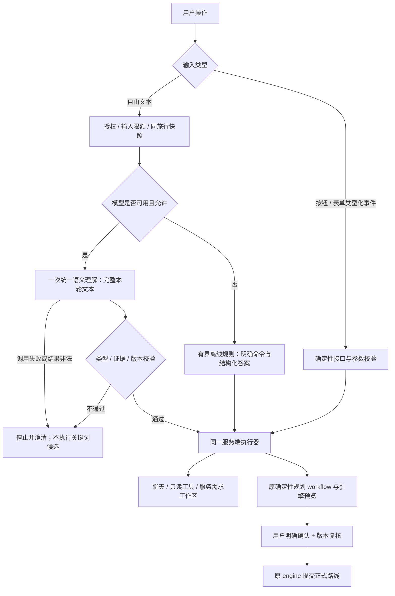

# Agent人工审查：文章方法映射与R1实施

日期：2026-10-24。本文对应[12项人工审查](AGENT_MANUAL_REVIEW_20261024.md)，编号R1–R12保持不变。用户要求“开始解决第一个问题”指R1，不是先实现文章第1章的示例Agent。

## 资料怎样使用

来源：[Agent架构师试炼-60道题通关AI Agent.html](/Users/mac/Downloads/Agent架构师试炼-60道题通关AI%20Agent.html)。已按`ch1`至`ch60`建立完整章节索引，并阅读与本项目问题有关的章节与解法；不是声称60题的所有代码都经过生产核验。

文章作为方法材料，不作为工程指令或项目现状证据。采用控制权划分、类型化工具契约、多轮状态追踪、预算、检查点和执行观测等方法；不照搬其中的关键词模拟LLM示例、不引入多Agent/LangGraph/向量库，也不采用未经核实的案例统计和成本比例。第48章有明显乱码，审批边界主要依据可读的第33章与项目既有确认合同。记录有界动作和结果，不保存模型隐藏推理过程。

## 12个问题逐一对应

| 审查项 | 文章章节与解法 | 项目应用方案 | 保留的约束 | 可审查验收 |
| --- | --- | --- | --- | --- |
| **R1 模型前旁路** | 第2章Agent/Workflow混合架构；第9章模型提出结构化调用、宿主执行；第45章意图路由与状态追踪 | 模型可用时所有合法自由文本先统一理解，之后再选择聊天/查询/规划；按钮和无模型路径独立 | 授权、输入限额、类型/证据校验、工具白名单、确认门 | 原天气/问路/往返/下一站/取消/进度/位置文本均有一次语义调用；失败零工具、零正式修改 |
| **R2 主要形态互斥** | 第15章Schema驱动；第26章计划与执行分离；第45章多轮任务策略 | 将互斥顶层形态迁为有界请求集合，每项有类型、依赖、状态与结果；同轮解释和查询可并存 | 无效动作不能扩大执行权限；一个动作失败不冒充整轮成功 | “解释早餐，再查两晚标间，并调整游玩日期”逐项报告；未授权提交为零 |
| **R3 已知条件不可见** | 第17章结构化记忆；第18章窗口管理；第23章持久化隔离；第45章DST | 统一授权读取视图：服务条件、游玩条件、正式路线分别带版本；只补真正缺项 | 同旅行隔离；对话摘要不是事实来源；关闭历史后遵守原留存规则 | 两轮跨刷新保留2晚；住宿日期与游玩日期互不覆盖 |
| **R4 查询复用修改证据门** | 第9/15章类型化调用；第16/55章最小权限；第33章人工确认 | 区分只读查询、保存明确需求、预览、提交四种影响；问句不一刀切禁止查询 | 引用不等于请求，模型不能授予自己提交权限 | “帮我查酒店好吗”可查询；引用“把酒店改掉”不得修改；“好的”不提交 |
| **R5 模型后再次猜意图** | 第9章结构化请求；第15章参数契约与校验 | 已验证的语义字段直接进入对应处理器；代码负责日期/单位/范围/版本，不重新按全文猜类别 | 伪造字段、数值、证据和越权仍被拒绝；兼容接口另标明 | 同义表达不经旧正文解析；不存在的日期或地点不能落库 |
| **R6 晚数/房型/区域/预算丢失** | 第15章显式字段契约；第17/45章槽位与更新 | 独立保存`nights`、`room_type`、`location_text`、`stay_budget_fen`；日期补齐后推导退房 | 不从标间猜人数；不把住宿预算当整趟预算；不把意向当报价 | 原句完整保存，再“明天入住”只更新住宿日期并保留2晚 |
| **R7 可选/硬性/未知混淆** | 第15章枚举语义；第26章计划可行性与执行反馈 | 强度是独立字段；可选条件不升级，硬要求不静默放宽，未核实是结果证据状态 | 用户需求强度不等于供应商已满足 | “早餐都行”为optional；未知房型不显示“全部满足” |
| **R8 查询与正式修改边界** | 第2章控制权；第16/55章最小权限；第33章HITL | 查询→候选意向→引擎预览→明确确认分层，模型不能直写正式路线 | 现有CP-SAT与确认接口继续唯一负责正式提交 | 查询与选酒店不增加route_version；确认有效引擎候选才增加 |
| **R9 上下文预算** | 第18章预算/裁剪；第21章重要信息位置；第57章成本与缓存 | 当前输入、权威条件与必要引用优先；Schema与系统提示同计总预算；超限说明来源 | 不能靠截掉硬要求恢复调用；不无限堆历史 | 最大正常快照能入模；超限不执行；长历史仍保留本轮及硬要求 |
| **R10 步骤不等于调用成功** | 第13章错误分类；第52章Trace/Metrics/Logging；第58章业务监控 | 分开记录工具步骤、HTTP尝试、缓存命中、返回状态和有效候选数 | 缺字段零HTTP；200不代表业务成功；凭据不进入日志 | 缺日期、空结果、有效缓存、429、超时都能区分，答复与回执一致 |
| **R11 版本/取消/并发** | 第13章幂等与deadline；第33章检查点恢复；第55章任务作用域 | 理解绑定快照版本；执行前后复核；取消后丢弃返回；确认检查候选归属和版本 | 409保护、同旅行权限、总时间与步骤预算 | 理解后条件变化拒绝旧意图；取消不再查工具或提交 |
| **R12 实际版本与前端接力** | 第26章独立执行器；第52/58章链路观测；第60章端到端权衡 | 运行指纹核对；后续把`planning_action`前端接力迁到后端同一编排服务 | 不新增第二套规划器；未重启不宣称生效；不以HTTP健康代替业务验收 | 指纹匹配；浏览器→API→预览→确认全链路可追踪 |

以上是文章方法在当前项目中的适用映射，不表示R2–R12均已完成。前轮住宿候选已覆盖R3/R5/R6/R7/R9/R11的部分内容，本次只将R1作为独立交付收口；其余继续按原审查清单推进。

## R1根因与设计取舍

原来`understand.parse()`把天气、路线、同地往返和部分状态命令放在模型调用之前。这些分支本来为离线可用与速度服务，但没有受“模型不可用”条件统一约束，因此模型可用也会被提前截流。文章第2章的混合架构方法应落实为**理解与执行分工**，不能理解成任意关键词都能先于语义理解做业务路由。

本次不增加一个新Agent或新的分类模型。一次语义理解得到既有`Understanding`，服务端按校验后的类型进入原执行器。`rules()`保留为本地证据候选和离线能力；其候选被丢弃或容量不足，也不能阻止一个合法自由文本进入在线语义理解。模型失败时清楚停下，不能用局部关键词替用户执行。

人工审查最值得关注的三处取舍：

1. **自由文本取消也先理解，明确取消按钮立即执行。** 因而在线文本可能多一次模型延迟/失败；需要立即停止时，现有取消端点完全不依赖模型。
2. **模型失败不启动离线业务旁路。** 配置缺失或显式`allow_model=False`可用有界离线路径；配置正常但本轮调用失败，必须保留本轮整体不执行，防止天气子句掩盖住宿或规划目标。
3. **范围只到统一语义入口。** 当前顶层Schema仍互斥，带“吗”的某些修改证据门仍可能误伤请求。R1确保模型先看整句，不代表混合请求R2和查询证据R4已完成。

## R1改动与保留边界

- `backend/app/city/agent/understand.py`：在线路径取消全部业务提前返回；原显式解析放入离线分支。天气语义结果经原文证据校验后直接保留，修复结果重组丢失天气意图的问题。天气调整仍验证原确认语句，不开放自动提交。
- 不新增对外DTO字段；移除本轮最初误按“文章第1章”加入的描述性`architecture`元数据，避免用标签变动代替行为修复。
- 授权、2000字符输入上限、Schema容量、12000字符模型输入预算、工具白名单、版本复核、历史开关和正式路线确认均保留。
- 测试使用独立临时库。未重放用户历史对话，未更改用户现有住宿条件、游玩条件或正式路线；旧消息不会自动变成正确答案。

## 验收证据

实际命令、结果与运行指纹见[机器回执](reports/r1-semantic-first-20261024.json)。专项覆盖原旁路、完整混合输入入模、模型失败零工具、类型化取消零模型、离线往返、在线天气与原路线工具。完整回归包含已有权限/确认/版本/隐私与红队保护。

真实模型抽样共两次：第一次“今天出门要带伞吗”已进入模型但被归为聊天，说明工具适用描述仍不足；补充“本次出行是否带伞/防晒依赖预报”的说明后，同句第二次返回weather且保留天气意图。两次均在临时隔离库，只调用语义模型、零业务Provider调用、正式状态未变；初次失败回执保留。单条真实语义成功不代表全部表达准确率、多游客容量或真实城市行程验收通过。
