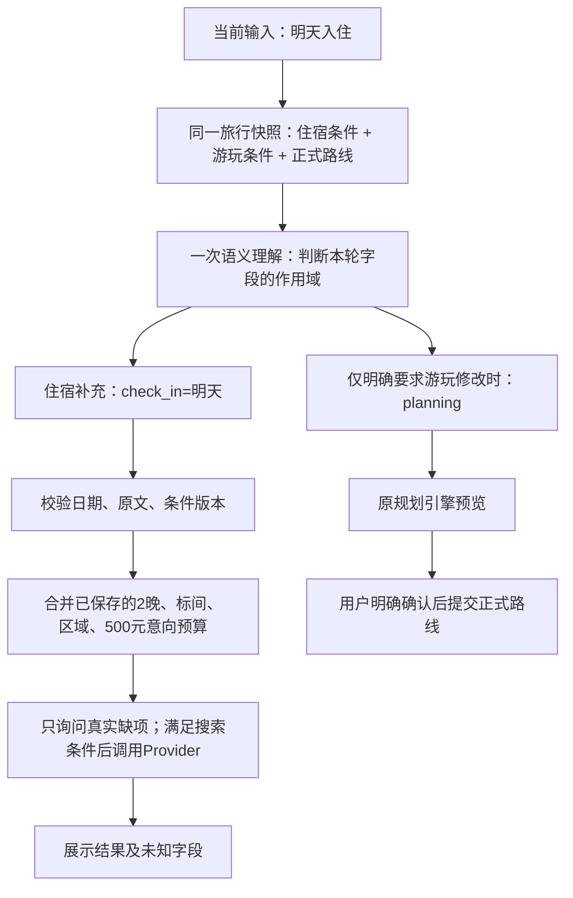

# 小汴梁关键决策人工审查包

2026-10-24 · 范围：聊天、查询、条件续接、规划与正式提交。按真实源码和指定旅行的只读状态核对。

**先审 R1、R2、R3、R4。** 目前有些限制是旧实现造成的，不能全部当成产品要求。我的建议是：自由表达与动作组合放宽，模型需要的上下文补齐；事实准入、作用域、版本和正式提交继续由代码控制。

住宿续接阶段的代码曾为**已回归但未加载的候选**，当时核对为`restart_required / backend_sha256`。后续按本页R1实施后，8017已重启并核对`current`，同时加载住宿候选；未重放你的历史请求、未修复运行库中旧住宿/游玩条件。最新代码、真实语义抽样和运行证据见[R1回执](reports/r1-semantic-first-20261024.json)；下方722项与“新增真实调用0”的成绩专指原住宿候选阶段。

这里所说的“放宽”应逐项讨论。分开存储住宿、规划和正式路线本身合理，问题在于**读取视图漏了住宿状态、字段缺少明确作用域、协议限制动作组合**。不需要为了修复这些问题把所有内容塞进一张表或改成开放式Agent。

## 原问题与候选链路

你提供的是：

> 我要标间，离清明上河园近的，住两个晚上，有没有早餐都行，住两个晚上，预算两天500
>
> 明天入住

运行状态实际只保存了`breakfast: hard`，没有保存晚数、房型、区域和预算；“明天入住”又被写进游玩规划工作区的`business_date`。所以住宿卡片继续问入住/退房，规划回复却追问游玩起止时刻。

图是这次候选的住宿续接链路。**一轮同时处理住宿与规划**仍属于R2待改造项，不能从图上的两条分支推断已能同时执行。

## 决策总表

| 编号 | 人工审查的问题 | 当前状态 | 我的建议 |
| --- | --- | --- | --- |
| R1 | 哪些自由文本可以在模型前直接分流？ | 本次已收口：模型可用时自由文本统一先理解；原显式入口只在离线分支 | 保留类型化按钮与有界离线能力；详见[文章映射与R1](AGENT_ARTICLE_REVIEW_MAPPING_20261024.md) |
| R2 | 一句话能否同时问问题、查酒店和提出规划修改？ | Schema仍将主要形态互斥 | 放宽合法动作组合；每个动作分别校验和报告结果 |
| R3 | 模型能看到哪些已经提供的条件？ | 候选新增住宿条件读取视图；存储仍各有职责 | 统一读取视图，保持住宿与游玩字段的作用域 |
| R4 | “吗”、否定、引用该在哪一层限制执行？ | 查询动作仍可能经过修改证据规则 | 区分查询、条件更新、正式提交的权限；避免用问号代替语义判断 |
| R5 | 模型理解后，代码是否再次用关键词改写含义？ | 候选让类型化住宿字段直接合并；兼容接口仍有旧解析器 | 语义路径不二次猜意图；代码只做类型、范围、证据与版本检查 |
| R6 | 晚数、房型、区域与预算怎样保存？ | 候选保存独立晚数、住宿合计预算和房型/区域意向 | 先保存明确字段，缺入住日期时只问日期；不擅自补人数和房间数 |
| R7 | 硬要求、偏好与“都行”怎样处理？ | 候选修正早餐可选；新字段保留强度 | 不把可选升级成硬条件，不把未知说成满足 |
| R8 | 查询一次是否会修改正式行程？ | 查询只写服务工作区；正式路线仍走原引擎确认 | 保留此边界；保存酒店意向与正式路线提交要明确区分 |
| R9 | 提示词、历史和状态如何分配输入预算？ | 中间回归暴露总长度超限，候选已压缩重复提示和Schema注释 | 保留总输入上限，优先保留当前条件；不要靠无限增加历史解决上下文 |
| R10 | 工具次数、Provider调用与成功结果是否分清？ | 搜索处理步骤可能因缺日期而零Provider调用 | 分开记录；“已执行查询”必须有实际调用或有效缓存回执 |
| R11 | 旧条件、取消与并发结果怎么保护？ | 候选使用理解时的服务条件版本，查询返回前再核对 | 保留409冲突和取消保护；不让旧结果覆盖新条件 |
| R12 | 当前运行的究竟是哪版？哪些业务仍由前端推动？ | 指纹可检测；规划仍有前端接力，尚未完成后端统一编排 | 保留指纹核对；前端接力作为独立迁移项，不与住宿修复混称完成 |

每项可批注为：**保留 / 放宽 / 重构 / 延后**，并附一个你希望系统实际怎样回答或执行的例句。以下是对应的实际实现和取舍。

## R1：模型前分流

代码：[understand.parse](/Users/mac/Desktop/大挑/kaifeng-tourism-mvp/backend/app/city/agent/understand.py:123)。

2026-10-24后续R1实施：模型可用且允许时，天气查询/调整、问路、往返、下一站、取消、进度与位置等自由文本统一先交语义模型；原确定性显式入口仅用于无模型或显式禁用模型的路径。规则候选只参与证据核对，不能在模型前选择业务路由。模型失败或输出非法时，停下并澄清，不能执行局部关键词结果。

按钮和表单继续通过类型化确定性接口，不增加模型依赖。天气语义结果被重组丢失的问题也已修复。具体根因、文章第2/9/45章解法、设计图、取舍与实际测试见[文章映射与R1实施](AGENT_ARTICLE_REVIEW_MAPPING_20261024.md)。下面其余条目仍保留原候选阶段与待审查边界，不能因为R1通过就标为全部完成。

审查例句：`看看明天天气，再帮我找清明上河园附近住两晚的酒店。` 现在完整进入模型；同轮分别执行和汇报两个请求仍是R2待实施目标。

## R2：输出形态互斥，仍是明确缺口

代码：[Understanding](/Users/mac/Desktop/大挑/kaifeng-tourism-mvp/backend/app/city/agent/models.py:118)。

现有验证器禁止`conversation`同时携带业务动作；候选增加`service_query`后也仍禁止它与`planning/route_query/weather_query`等同轮出现。这是当前实现限制，**不是用户必须一次只说一件事的产品规则**。

建议后续把一轮结果改为有界`requests[] + requirement_patches[] + answer_parts[]`，按动作分别校验、执行和汇报。保留同一执行器和原引擎，不增加多Agent或第二套求解器。解释文字不能取得写权限；一个请求缺字段时只阻断其依赖项。

建议的目标例子：`早餐是否包含是什么意思？顺便查明天入住两晚的标间。` 可先回答概念，再执行酒店查询。当前候选仍不能把这类混合请求标为已完成，需单独实施和验收。

## R3：统一读取，而非混淆业务状态

代码：[Snapshot](/Users/mac/Desktop/大挑/kaifeng-tourism-mvp/backend/app/city/assistant/context.py:25)、[模型上下文](/Users/mac/Desktop/大挑/kaifeng-tourism-mvp/backend/app/city/agent/conversation.py:7)。

之前上下文有游玩条件与部分历史，但没有结构化住宿条件。候选在同一授权数据库快照读取服务工作区，向模型提供其版本、日期、晚数、房型、区域、预算、属性强度和缺项。不提供凭据、全部供应商原始结果或其他旅行数据。

字段仍明确区分：`planning.business_date`是游玩日期，`services.check_in`是入住日期，`services.stay_budget_fen`是住宿合计预算。不能因为都叫“日期/预算”就相互覆盖。近期聊天只帮助理解指代，不能代替本轮修改授权或事实来源。

审查例句：先说`住两个晚上`，再说`明天入住`，第二轮应读到已保存晚数；另说`游玩日期改后天`时不能静默改酒店日期。

## R4：证据门的粒度仍需要调整

代码：[grounded](/Users/mac/Desktop/大挑/kaifeng-tourism-mvp/backend/app/city/agent/understand.py:102)、[request_evidence](/Users/mac/Desktop/大挑/kaifeng-tourism-mvp/backend/app/city/agent/evidence.py:17)、[类型化住宿校验](/Users/mac/Desktop/大挑/kaifeng-tourism-mvp/backend/app/city/travel_services.py:71)。

当前规则有`吗$`、假设、引用、否定等匹配；部分查询动作和住宿字段也会复用此规则。它能防止把引用或教程当修改，却可能误伤`能帮我查明天入住的酒店吗`。本轮没有宣称已经解决所有间接请求。

建议分三层：只读查询判断真实查询意图；保存需求字段检查本轮明确的字段及作用域；正式路线或重要目标改动继续走预览与明确确认。保留对外部引用、否定、越权、伪造数值的检查，不用“带吗就不能执行”作为最终意图判断。

## R5：语义输出怎样落到代码

代码：[ServiceIntent](/Users/mac/Desktop/大挑/kaifeng-tourism-mvp/backend/app/city/agent/models.py:95)、[semantic_requirements](/Users/mac/Desktop/大挑/kaifeng-tourism-mvp/backend/app/city/travel_services.py:71)、[Agent执行](/Users/mac/Desktop/大挑/kaifeng-tourism-mvp/backend/app/city/agent/service.py:461)。

候选接受`service_query.fields`类型化字段；语义路径直接按版本合并，**不再调用旧正文解析器二次决定字段**。日期由代码换算，数值、单位作用域、原文和属性强度仍校验。兼容`/services/query`以及旧`search_services`动作保留受限解析；它们不是已完成统一语义协议的证明。

仍有取舍：当前字段名和部分证据词是有限白名单，能避免模型任意写状态，但也限制新表达与新能力。建议后续按业务能力维护类型化字段契约，而非继续堆全局关键词。新API接入注册表，不授予模型任意URL或任意字段写入。

## R6–R7：这段住宿对话应留下什么

代码：[晚数与日期](/Users/mac/Desktop/大挑/kaifeng-tourism-mvp/backend/app/city/travel_services.py:52)、[原句回归](/Users/mac/Desktop/大挑/kaifeng-tourism-mvp/backend/tests/test_service_followup.py:21)。

| 原文 | 候选保存值 | 不应推断的内容 |
| --- | --- | --- |
| 我要标间 | `room_type=标间` | 不据此推断两个人、一间房或具体房型可订 |
| 离清明上河园近的 | `location_text=清明上河园` | 没有距离依据不能声称近、步行几分钟或入口可达 |
| 住两个晚上 | `nights=2`，入住日期未知时也保存 | 不能因为尚无入住日期就丢掉晚数 |
| 有没有早餐都行 | `breakfast.strength=optional` | 不能升级为必须含早餐 |
| 预算两天500 | 暂作为住宿合计预算意向`stay_budget_fen=50000` | 不当作每晚500，不声称500足够，不覆盖整趟总预算 |
| 明天入住 | `check_in=按本轮日期换算的明天`，按2晚计算退房 | 不修改游玩日期，不追问游玩起止时刻 |

**需你审查的含义选择：**“住两个晚上”与“预算两天500”合用时，候选暂按两晚住宿合计500元理解。如果你希望所有“天数/晚数不一致”的表达先补问确认，应把这个规则改成预算范围待确认；两种策略都不能把预算意向当作已核实报价。

Provider当前搜索不能核实标间、早餐、区域距离与入住总价。候选保留这些用户条件，并将房型/位置列为未核实，不据此显示“硬条件全部满足”。日期改动保留晚数；明确退房日期优先重新核对区间，不静默保留冲突日期。

## R8：意向、候选与正式路线

代码：[服务查询](/Users/mac/Desktop/大挑/kaifeng-tourism-mvp/backend/app/city/travel_services.py:176)、[候选意向确认](/Users/mac/Desktop/大挑/kaifeng-tourism-mvp/backend/app/city/travel_services.py:275)、[正式路线确认](/Users/mac/Desktop/大挑/kaifeng-tourism-mvp/backend/app/city/engine/service.py:213)。

查询可保存本旅行的服务条件和候选；选择酒店保存的是意向，不等于预订、支付或正式路线提交。正式路线仍由原引擎预览并复核，用户明确确认后写入。不能为了对话顺畅，把一句“好的”当成下单或改路线。

这个边界建议保留。应放宽的是表达和组合，不是用模型回复替代真实业务回执。

## R9：输入预算也会造成模型前拒绝

代码：[prompt_schema与提示词](/Users/mac/Desktop/大挑/kaifeng-tourism-mvp/backend/app/city/agent/understand.py:16)、[上下文裁剪](/Users/mac/Desktop/大挑/kaifeng-tourism-mvp/backend/app/city/agent/conversation.py:67)、[模型适配器上限](/Users/mac/Desktop/大挑/kaifeng-tourism-mvp/backend/app/city/agent/provider.py:42)。

本轮中间回归曾97项失败，主要暴露新增Schema和重复提示占满12000字符总预算，正常请求在模型调用前返回“信息过多”。候选压缩重复提示，仅从发送给模型的Schema去掉`title/description/default`注释，保留字段、枚举、长度、类型及互斥校验；导出合同仍保留完整Schema。住宿上下文只放有限字段及属性值/强度，不复制全部原文证据。

建议保留有界输入。上限、裁剪顺序和超限原因应可观察；不能将系统提示过大归咎为用户没有说清楚。最终完整回归已恢复通过，成绩见下节。

## R10–R11：执行证据、并发与取消

工具步骤、实际外部调用、有效缓存、无匹配、缺条件和授权失败必须区分。比如第一轮已知2晚但缺入住日期，应零酒店API调用，并明确只问入住日期；不能将工具处理步骤1次写成真实查询成功1次。

候选将Agent理解时读取的服务工作区版本传入查询；若期间已被另一请求修改，返回409，不用最新版本悄悄接纳旧意图。外部结果回来后再核对服务版本、旅行版本和取消标记。正式状态、进度与锁定目标不被酒店查询覆盖。导出/删除仍沿用旅行作用域与原有隐私约束。

## R12：运行状态与仍在前端的编排

代码：[运行身份](/Users/mac/Desktop/大挑/kaifeng-tourism-mvp/backend/app/runtime.py:35)、[核对命令](/Users/mac/Desktop/大挑/kaifeng-tourism-mvp/scripts/runtime_status.py:1)、[前端规划接力](/Users/mac/Desktop/大挑/kaifeng-tourism-mvp/frontend/src/components/CityAgentChat.vue:71)。

`runtime_status.py`比较启动时与磁盘的目录标识、源码指纹和Git HEAD，能检测未提交源码变化。住宿候选阶段曾返回`restart_required`，说明当时8017仍是旧后端；R1后续实际加载状态见[本次机器回执](reports/r1-semantic-first-20261024.json)，不能用磁盘测试结果代替运行身份核对。

规划请求仍会返回`planning_action`，由前端调用规划组件继续处理。完整后端统一编排、统一条件归并和组合请求尚未完成。这些缺口需要列成明确交付项，而不能因住宿续接测试通过就宣布统一方案完成。

## 本轮证据与未做的事

| 验证 | 结果与边界 |
| --- | --- |
| 完整后端 | **722 passed**，1项既有依赖弃用警告；临时库/Mock，不代表真实语义准确率 |
| 中文住宿专项 | 7项，包含原句两轮续接、字段不二次解析、中文晚数、可选早餐、数值/作用域/属性伪造；包含在722中，不相加 |
| 手机端旅行服务 | **3 passed**：原能力问句、查询确认撤销、中文住宿跨刷新续接 |
| 原Agent浏览器 | **7 passed**：预览确认、取消、资料不足、协商、过期候选与正式路线保护 |
| 前端构建、导出合同、差异空白检查 | 通过 |
| 真实模型/酒店API | 本轮新增调用0；不能从Mock成绩推断真实模型一定按候选字段输出 |
| 你的现有旅行 | 仅读取指定旅行诊断状态；未重写历史、住宿条件、游玩条件或正式路线 |

复现命令与日志清单见[本轮机器回执](/Users/mac/Desktop/大挑/kaifeng-tourism-mvp/docs/reports/service-followup-review-20261024.json)。上轮715项与真实能力问句回执只适用于上轮代码，不能替代这次新增住宿协议的真实模型验证。

审查建议顺序：R1是否坚持所有自由文本先语义理解 → R2是否允许同轮动作组合 → R3各字段权威来源和作用域 → R4查询与修改证据分层 → R6预算歧义 → 其余执行与提交保护。可以直接在本文件相应段落批注；不用先审完整仓库的其他工作。
