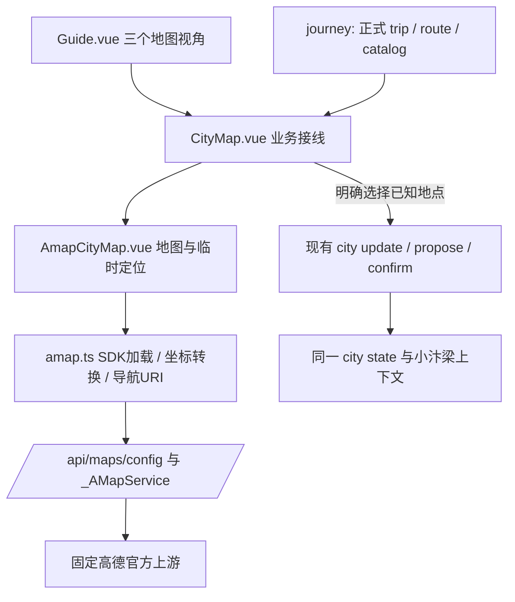

# M4.2 地图与定位 MVP

> 本页是M4.2隔离交付报告，其中“未重启8017”“运行旧页面”等是当轮操作记录。2026-10-23主版本后续接入和服务切换见 [合并验收](MAIN_REFERENCE_MERGE_ACCEPTANCE.md)；本页真实SDK、合成定位与设备未验收边界仍有效。

日期：2026-10-23。任务原文见 [AMAP_MAP_LOCATION_TASK.md](reference/AMAP_MAP_LOCATION_TASK.md)。

## 交付结论

已经实现并在隔离环境验证真实高德 JS API 2.0 底图、三种路线插件及页面步行绘线。位置权限与定位成功/失败使用浏览器模拟验证；真实手机 HTTPS 定位、真实入口及园内通行仍未验收。整体状态为 **PARTIAL：工程地图闭环通过，现场数据与设备验收待完成**。

本轮没有重启 8017，没有替换 `frontend/dist`，没有写正式数据库，没有启用正式城市交通 Provider。运行中的旧页面不自动获得本轮新代码；发布需要另行安排正常后端重启与前端构建切换。本轮可审查构建位于 `.test-results/amap-m42-dist`。交付时启动独立验收入口 `http://127.0.0.1:8023/guide?mode=city`，使用临时空城市业务库；服务关闭时临时库删除。

## 组件与数据流



- `/guide`、`?mode=city` 使用开封城市视角；`?scenic=wansui`、`?scenic=qingming` 使用同一地图实例切换已核验地点附近视野。没有对应景区坐标时保留城市视角并说明，不推算景区中心。
- 旧 `GuideMap.vue` 的示意交互保留在显式 `?demo=1` 入口；不会作为真实地图使用。选中匹配景区时提供“进入园内游览”链接；只切视角，不凭定位自动入园或改进度。
- 详情页的 `ExternalMap.vue` 也复用安全 SDK 加载器，删除旧 `VITE_AMAP_SECURITY_CODE` 明文路径。搜索结果明确是地图 POI，并非核验入口。
- 没有新增依赖或第二份正式行程。正式路线、进度、权限、确认、M7 留存与删除继续使用原模块。

## 配置与安全代理

本机 `.env` 已按用户本轮提供的截图配置 `AMAP_JS_KEY`、`AMAP_JS_SECURITY_CODE`，权限 `0600`；未在代码、构建或报告中写入真实值。后端 `AMAP_WEB_SERVICE_KEY` 独立保留，未拿来充当 JS Key。

`GET /api/maps/config` 只返回公开浏览器 Key、版本与同源 serviceHost；安全密钥仅在服务器请求上游时追加。前端在官方 SDK 脚本加载前设置：

```js
window._AMapSecurityConfig = {
  serviceHost: location.origin + '/api/maps/_AMapService'
}
```

代理 `/api/maps/_AMapService/{path}`：

- 只允许 GET 和列明的官方初始化、样式、定位、坐标转换、地点与路线接口，固定 `restapi.amap.com` / `webapi.amap.com`，禁止任意 URL、路径穿越、密钥覆盖和跳转。
- 检查 Origin、Referer、Sec-Fetch-Site；进程内每 IP 120 次/分钟、最多 1024 个桶。此限制不等于跨进程总配额，公开部署仍需域名限制和边缘限额。
- 单次网络超时 10 秒、响应上限 2 MiB、参数长度/数量有限；不转发用户 Cookie、Authorization 或上游 Cookie，不跟随重定向，不落地原始响应。
- 只允许合法 JSONP 回调标识。兼容 SDK 实际发送的两个相同 `s` 参数并规范为一个；其他重复参数或不同值拒绝。
- JSONP 按 `application/javascript` 返回，同时保留 `nosniff`。真实联调曾遇到上游将 JSONP 标为 JSON，导致 HTTP 200 但插件无法执行，已修复并补测试。
- 上游 httpx 日志使用既有敏感参数过滤；新增 Uvicorn 地图访问日志过滤，整段 query（含位置/Key）不写日志。所有地图响应设置 no-store。部署到其他网关时也应禁止其记录敏感 query。

重新配置使用隐藏输入：

```bash
.venv/bin/python scripts/configure_amap_js.py
```

本轮沿用用户明确提供的凭据完成验证，没有操作高德控制台进行轮换或域名设置。截图中已公开的凭据应在正式使用前轮换；脚本不替用户购买、充值或更改授权。

## 定位与状态边界

点击“我在这里”才调用一次 `AMap.Geolocation`；未调用 watchPosition、未开启持续追踪。成功结果在当前组件内保存：GCJ02 经纬度、source、实际返回的 location_type/type、获取时间、accuracy_m（无值即 null）。融合定位不统称 GPS。

位置有效期为 15 分钟。自动定位若为 IP、精度未知或误差超过 200 米，不作为路线起点；200 米为本轮交互门槛，不是定位服务准确率承诺。手动位置经过用户确认后可作为临时起点，精度依旧显示未知。未来时间和过期时间均无效。

- 权限拒绝、超时、设备不支持、非安全上下文：说明原因，可搜索已核验目录地点或点击地图选点。
- 地图点击只产生待确认点；点击“确认作为临时出发位置”后才使用。选中已知地点也需明确确认后作为临时起点。
- WGS84 地点必须通过官方 `convertFrom(..., 'gps')` 转成 GCJ02，失败或超时则不绘制，不静默混用坐标。
- 临时精确位置不进 localStorage/sessionStorage、聊天摘要或数据库。清除、页面卸载、旅行切换及 memoryEpoch 变化会清空，过期会清除路线。
- “使用已保存位置”仅读取仍新鲜的已知地点 anchor；无可用 GCJ02 坐标或已过期时要求重新选择。
- 用户明确点击“确认我在此已知地点，并设为旅行当前位置”才调用现有授权 API，载荷只有 place_id 与 confirmed_at。来源仍是 `manual_known_place`；需要候选确认时沿用现有确认接口。任意坐标不新增服务端字段，不伪装成 GPS 锚点。
- 小汴梁读取同一后端 anchor，不自动读取页面临时点。后端专项测试验证地图保存后助手上下文可见该锚点、`live_tracking=false`，查询不改状态。

## 正式行程与 Marker

`CityMap.vue` 读取 `journey.trip / journey.route / journey.catalog`，只有 trip ID、version、route_version 一致、未 stale 且未超期的已确认路线才产生“已确认/当前/下一站/已完成”等路线状态。进行中的活动也读取 itinerary.ongoing.original_activity，不依赖聊天推断。

地图区分当前位置、已有地点、已确认、正在游览、下一站、已完成、已跳过与锁定目标。地点类型区分商家、舞台、普通 POI、核验入口。入口必须同时具备已核验的入口关系，普通景区 POI 不升级成入口。

仅绘制 ready、非 demo、核验有效、有来源、合法坐标系的目录地点。缺坐标的正式活动单独列出，未核验和示意点不补坐标。选择 Marker 或列表显示同一详情卡，可打开详情、加入素材篮；素材篮不是正式路线提交。

页面挂载、窗口重新获焦和手动刷新均读取现有城市接口；预览的版本变化会清除旧路线和旧位置候选。正式变更仍由服务端 CAS/事实校验与事务提交控制。

## 路线与外部导航

Walking / Driving / Transfer 经官方插件查询，默认步行。由 SDK 用真实返回结果绘线，页面显示返回的米数及分钟数；失败、超时、换地点、换交通方式、切视角和版本变化均清除旧预览。异步回调有版本令牌，旧插件实例解绑地图，迟到结果不能覆盖新选择。

地图查询结果只存在当前界面，不导入 `city.operations`、不修改 OR-Tools 或正式交通 Provider、不持久化路线几何和矩阵。地图上的通用步行线不证明景区内部可通行，也不承诺赶上演出。

外部导航使用 `https://uri.amap.com/navigation`，`URLSearchParams` 编码 `to/from/mode/coordinate/src/callnative`。三种方式映射 walk/car/bus，明确 `coordinate=gaode`。无可靠起点时省略 from，由外部地图让游客选择。只有核验入口才使用入口措辞。URI 结构已测；实际调起手机高德 App、外部导航再返回及现场路径仍需设备验收。

## 验证与真实证据

运行结果以同目录 [JSON 报告](reports/amap-map-location-mvp.json) 为准。

- 后端专项：安全配置/代理、错误/超时、限额、日志脱敏、JSONP、已知地点锚点与助手共享。
- 全量后端 **565 passed**，地图专项 **27 passed**：隔离临时数据库，包含既有 Agent/规划/记忆回归。修复一条原有测试的午夜时钟依赖，生产业务校验未放宽。
- TypeScript 与独立 Vite 构建通过。未覆盖现有 dist。
- 浏览器联合验收 **13 passed**（含真实在线用例），最终构建离线复验 **12 passed**。375×812 Chrome：正式状态、缺坐标、三视角、拒绝定位、粗定位、手动确认、清除、SDK 故障、三插件、迟到响应、显式锚点写入及无自动持久化等。
- 真实 SDK：底图资源返回且人工截图可见开封道路/地名；Walking/Driving/Transfer 均返回 complete、路线、距离与耗时；页面真实 Walking 绘线成功。真实请求使用城市测试坐标与合成业务状态，不发送真实游客资料，也不是景区实地验证。
- 前端 src、构建和相关报告扫描未发现实际凭据值；原 dist 与并行文件指纹检查通过。
- 真实 Chrome 为本机桌面 Chrome 的 375px 模拟视口，不等于 iOS/Safari/Android 实机覆盖。

真实底图与步行预览截图：`.test-results/amap-m42-real-mobile.png`。合成界面截图：`.test-results/amap-m42-synthetic-mobile.png`。截图为验收证据，未下载底图瓦片、原始高德路由响应或几何数据。

可复现命令（均在项目目录，构建步骤在 frontend 目录）：

```bash
.venv/bin/pytest -q
.venv/bin/pytest -q backend/tests/test_maps.py
cd frontend
./node_modules/.bin/vue-tsc --noEmit
./node_modules/.bin/vite build --outDir ../.test-results/amap-m42-dist
./node_modules/.bin/playwright test --config playwright.amap.config.ts
# 显式在线：包含真实三插件和页面步行预览，共4次路线查询；可能消耗高德配额。
AMAP_LIVE_TEST=1 ./node_modules/.bin/playwright test --config playwright.amap.config.ts --grep 'REAL SDK'
```

独立服务 `scripts/amap_map_test_server.py` 绑定 127.0.0.1:8023，临时数据库与独立删除台账，LLM 关闭，访问日志关闭。正常退出删除临时库；默认不预埋合成业务资料，浏览器 fixture 只通过测试拦截注入。

## 尚待验收

| 分类 | 结论 |
| --- | --- |
| 已实现且真实验证 | JS API 配置/安全代理、在线底图、三插件实际查询、页面步行预览 |
| 已实现但主要模拟验证 | 授权定位成功/拒绝/粗定位、时效、异常降级、正式状态投影与显式保存操作 |
| 设备或环境未验证 | 手机 HTTPS 实际定位、Safari/Android 差异、真实 App 调起、跨 App 返回 |
| 数据依赖 | 景区核验坐标、入口关系与当日开放、园内路网、真实行程点位和场次 |
| 本轮不实现 | 持续追踪、任意坐标长期记忆、GPS 自动判入园、园内新道路、正式交通 Provider 自动准入 |

真实业务目录不足时，地图仍可使用在线底图、临时选点和外部高德；业务 Marker 保持空缺，不把测试夹具导入正式库。

## 修改文件

新增：`backend/app/maps.py`、`backend/tests/test_maps.py`、`frontend/src/amap.ts`、`frontend/src/components/AmapCityMap.vue`、`frontend/tests/amap-map.spec.ts`、`frontend/playwright.amap.config.ts`、`scripts/amap_map_test_server.py`、`scripts/configure_amap_js.py`，以及本文、任务归档和相关报告。

增量修改：`backend/app/main.py` 注册地图路由与 no-store；`frontend/src/components/CityMap.vue`、`ExternalMap.vue`、`frontend/src/pages/Guide.vue` 接线；`frontend/src/cityApi.ts`、`explorationApi.ts` 补只读类型；`.env.example` 移除前端安全密钥配置；`backend/tests/test_city_state.py` 固定一个午夜敏感用例时钟。`.env` 仅本机凭据配置，不作为交付源码。

未修改 Agent 求解或记忆实现、OR-Tools、数据库 schema、生产数据、`frontend/src/App.vue`、`frontend/src/journey.css` 或当前运行 dist。

## 官方依据

- [JS API 2.0 加载](https://lbs.amap.com/api/javascript-api-v2/guide/abc/load)
- [安全密钥与 serviceHost 代理](https://lbs.amap.com/api/javascript-api-v2/guide/abc/jscode)
- [定位](https://lbs.amap.com/api/javascript-api-v2/guide/services/geolocation)
- [坐标转换](https://lbs.amap.com/api/javascript-api-v2/guide/transform/convertfrom)
- [路线插件](https://lbs.amap.com/api/javascript-api-v2/guide/services/navigation)
- [官方 URI 参数](https://lbs.amap.com/api/uri-api/guide/travel/route)

真实 SDK 请求观察补充了必要初始化路径、重复 s 参数与 JSONP MIME 的兼容证据；没有因此放开任意上游代理。
