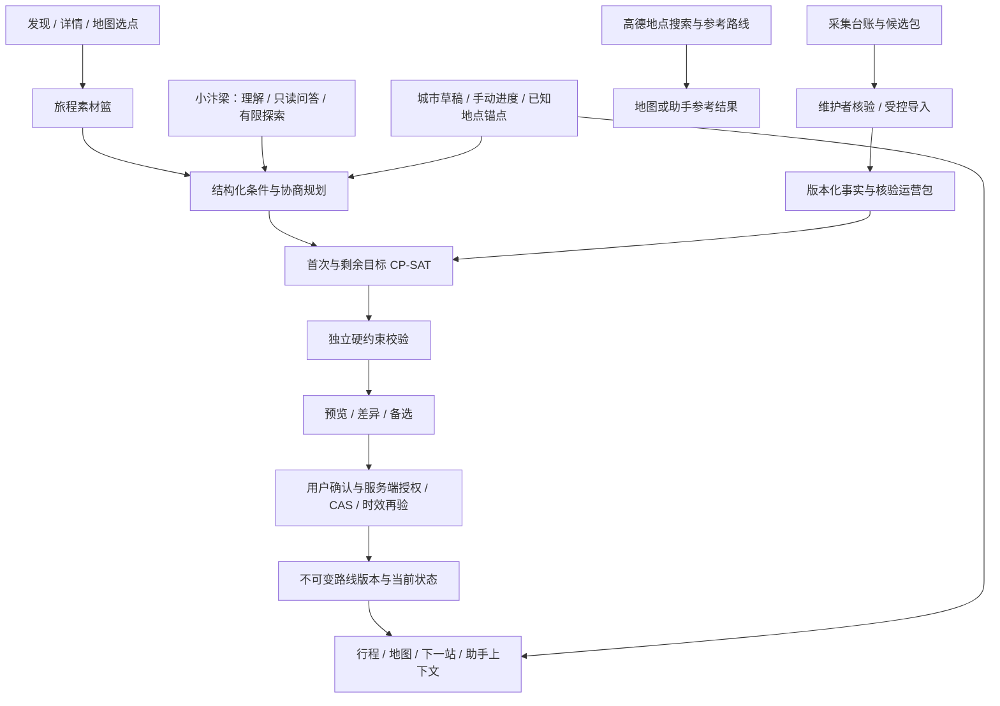

# 当前工程架构

核对日期：2026-10-23。本文描述主目录代码的连接关系；完成度和数据快照见 [PROJECT_STATUS.md](PROJECT_STATUS.md)。产品边界以 [PRD](PRD.md) 为准，[AI_ARCHITECTURE](AI_ARCHITECTURE.md)保留目标设计。

## 实际连接

图表示代码接线，不能据此推定已有真实业务资料。高德参考查询独立于正式规划：明确起终点时不要求游客 GPS，结果不自动写入正式路线或运营矩阵。正式引擎仍要求可用事实、交通时段依据与出入口关系。

## 模块职责

| 模块 | 当前职责与边界 |
| --- | --- |
| `backend/app/city/facts.py`、`storage.py`、`state.py` | 来源、地点、入口、规则、节目/场次、菜品/商家/供应；城市草稿、进度、锚点、幂等及事务 |
| `city/basket.py`、`city/exploration.py`、`city/exploration_state.py` | 旅程隔离素材篮、结构化条件、缺项、协商与引擎适配；篮子和预览均不是正式行程 |
| `city/engine/` | 活动候选、方向交通矩阵、CP-SAT、首次/剩余规划、独立复核、预览确认、路线版本与恢复候选 |
| `city/agent/`、`city/assistant/` | 单 Agent 理解、合法工具选择与只读上下文；V2兼容；模型没有正式提交工具 |
| `city/location_resolution.py`、`city/agent/reference_routes.py` | 地点匹配及参考问路；地图 POI 不升级为已核验入口 |
| `backend/app/maps.py` | JS API 配置及固定官方上游代理；安全码留在后端 |
| `backend/app/model_schedule.py` | 模型请求预算与同进程限流；没有跨进程或多实例总配额保证 |
| `collector/` | 任务、来源、采集、核验台账与质量报告；独立 `collection.db`，不直接写游客事实库 |
| `frontend/src/journey.ts`、`cityApi.ts`、`explorationApi.ts` | 同一旅程、目录、篮子、正式路线、进度和删除同步 |
| `pages/Assistant.vue`、`JourneyPage.vue`、`BasketPage.vue`、`components/BasketPlanning.vue` | 条件收集、规划预览及确认、纵向行程与下一站 |
| `components/CityMap.vue`、`AmapCityMap.vue` | 有效版本的正式状态投影；临时定位/选点与参考路线保持各自语义 |
| `backend/app/memory/` | 访客会话、属主、留存、导出、删除台账；无账号或长期偏好恢复 |
| 旧 `paths.py`、`itinerary.py`、`planner.py` | 单景区兼容入口；其限制不能泛化为新城市引擎的限制 |

技术栈保持 Vue/FastAPI/SQLite 模块化单体，NetworkX + OR-Tools；没有新增多 Agent、LangGraph、RAG或自建城市导航服务。

## 状态、事实与提交

- `place_id` 是地点，`stop_id` 是活动，独立日期场次另有身份；同地多场不会因地点相同而自动去重。
- 草稿版本与 `route_version` 分开。未确认路线时为0，确认生成不可变新版本；进度、事实或版本失效时，旧路线不继续认证可执行。
- 来源、核验、许可、日期及依赖由服务端检查；`ready` 是单项事实准入状态，不是整条路线可行性证明。
- 自然语言及影响重要目标的变更先预览。正式写入重查会话、属主、版本、候选时效与事实指纹，事务保存状态、路线及回执。
- 剩余规划保护已完成/跳过前缀、当前活动及锁定目标，从有效锚点与当前时间接续，不从原入口重新开始。
- 精确临时定位不进入长期存储或聊天；游客明确确认的已知地点以 `place_id` 锚点保存。无持续 GPS 追踪。
- 城市私有对象受 M7 导出、TTL、删除及恢复门禁保护，备份恢复不能回滚独立删除台账。

接口及字段以 [城市存储](CITY_STORAGE_AND_FACTS.md)、[规划引擎](PLANNING_ENGINE_V1.md)、[V3](CITY_AGENT_V3.md)和 [contracts/](contracts) 为准。代码入口为 `city/api.py`、`city/engine/api.py`、`city/agent/api.py`，不要依赖历史报告中的接口猜测。

## 已知差距

正式运行库缺城市事实和运营包；参考路线到保守时段矩阵的准入、园内核验道路、真实商家与日期场次、手机实机及现场验收仍未完成。软件接线不能替代上述验收。

`GET /api/city/v1/capabilities` 目前将 `planning_tools_available=true` 与 `city_planning_available=false` 分开，但其 `not_connected` 中仍含过时的前端描述。本轮保留接口行为，登记为后续代码修正，不能据此否定已有前端接线或宣称正式城市服务可用。

最新测试证据见[合并验收](MAIN_REFERENCE_MERGE_ACCEPTANCE.md)。旧阶段报告在[历史归档](archive/README.md)，其中的测试数、端口、未接通项只描述对应时点。
