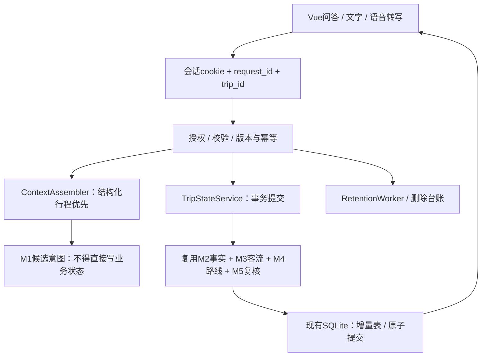

# M7 访客状态现状与城市行程扩展

状态核对：2026-10-23。城市需求、手动进度、锚点、候选确认、版本、幂等、导出与删除已接通；城市首次/剩余规划及不可变路线版本也已实现。未确认时 `route_version=0`，确认后递增。见 [存储与事实](CITY_STORAGE_AND_FACTS.md)、[规划引擎](PLANNING_ENGINE_V1.md)及[项目现状](PROJECT_STATUS.md)。

以下城市扩展表保留为约束与兼容要求，旧单景区实现契约继续有效。真实城市路线、现场接续、旧行程显式转换、真实账号与跨设备恢复仍未完成；不要将旧单景区的拒绝重规划行为套用于新城市引擎。

原始 [M7 规格](reference/M7_Memory_Architecture_v1.pdf) 保留为来源；其会话、版本、授权和删除原则继续适用，单景区范围由本版的城市行程目标补充。下面先列新目标，再保留当前单景区实现契约，不能把目标字段当成已可调用接口。

## 城市行程扩展约束与兼容基线

旧单景区模型以单个 scenic_id、单份 PlanRequest 和 route_id 组织行程。城市模型必须容纳景区段、餐饮、城市地点、转场和返程；用户从园内切到园外时保持同一城市 trip。切换地图视图不能新建行程。主动另开一次旅行才创建新城市 trip。

| 对象 | 需要增加或调整 | 必须保持的约束 |
| --- | --- | --- |
| 城市行程 | 单日时间范围、起终点、交通方式、锁定目标、当前活动和全程版本 | 服务端是权威，owner 从会话确定 |
| 活动与场次 | 全局 stop_id、place_id、session_id、段归属、完成或跳过、实际与预计时间 | 同地不同场次可区分；已完成前缀不被重算清空 |
| 转场 | 前后活动、模式、入口转换、来源及估时有效期 | 不同图和坐标系不直接混合；缺时间不填零 |
| 当前锚点 | 用户确认的 place_id 或路网节点、确认时间及来源 | V1 先用手动地点；不存连续 GPS 轨迹 |
| 变更候选 | 原版本、受影响活动、事实版本、锁定项影响及失效时间 | 自然语言提议不能直接写入；事实变化后需重新核验 |
| 留存与删除 | 城市行程及所有活动、转场引用、候选、摘要和缓存关联 | 过期不可读、导出与删除覆盖全部新增对象；不扩大保留期 |

位置锚点仅供确定性规划服务使用。即使是手动地点，也属于该行程的状态；不将位置序列发送到 LLM 或写入通用日志。后续如使用设备定位，需另定义精度、时效、坐标与最小留存规则；旧接口禁止接收 GPS 的规则不能自行绕过。

重规划流程为：验证会话与 expected_version → 读取当前锚点和未完成目标 → 查询最新事实 → 求解剩余活动 → 独立复核 → 检查版本及事实依赖仍有效 → 原子提交路线和进度。求解在事务外；提交失败不写半份行程。旧计划如受取消或过期影响，保留记录但标记失效部分。

明确的按钮操作可携带类型化修改请求；自然语言仍走候选确认。涉及取消必看或放宽锁定目标时展示影响并确认。实现前须扩展服务端 schema 与校验，不能让前端直接写 constraints_json 或通过聊天摘要覆盖约束。

### 兼容和迁移步骤

1. 新城市模型与旧单景区接口分别版本化，先保存契约与样例，再增量建表或加字段。保留现有数据、属主和删除台账。
2. 旧 trip 只在可验证属主和有效会话下，显式转换为一个城市行程内的单景区段；记录 legacy_trip_id 映射并保证迁移幂等。没有属主的旧路线继续拒绝读取，不因迁移自动认领。
3. 读取适配器根据 schema 版本区分旧新记录。旧客户端继续读旧语义；城市界面不能把不完整的旧段显示为全程已经规划。
4. 使用副本验证旧数据可读、并发修改、候选失效、失败回滚、导出、TTL 和删除台账重放，再接入运行库。回退新功能时不得回滚当前删除台账。
5. 有已完成活动时必须先接通当前锚点和剩余路线；不能删除现有拒绝逻辑后仍从原 gate 重算。该能力是 V1 必做，不再仅列远期导航扩展。

城市契约和状态接口现已实现，具体路径见顶部操作说明；现有 `/api/v1/trips` 保持旧语义。长期偏好、真实账号和跨设备恢复仍待 V2 的身份与同意机制；已有访客记忆继续保留。新验收用例见 [DEVELOPMENT_DIRECTION.md](DEVELOPMENT_DIRECTION.md)。

## 当前单景区实现与历史迁移对照

以下记录已接入代码的单景区 M7 框架；不是城市扩展的实现成绩。示例游客信息不进入业务数据库。

### 旧版迁移对照

| 领域 | M7 接入前 | 当前单景区实现 |
| --- | --- | --- |
| 身份 | 无登录、无服务端游客身份 | 服务端随机令牌、仅保存哈希、HttpOnly/SameSite cookie、对象级授权、滑动24小时TTL |
| 行程 | `plans` 不可变结果，无当前行程版本 | `trip_states` 独立权威，状态机、约束、排除/完成点、版本、路线版本、CAS原子提交 |
| 重规划 | 每次请求另存一个结果 | 维持同一trip，版本匹配且求解/复核成功后原子提交新路线；失败保留旧版本 |
| 对话 | 浏览器临时历史和需求草稿 | 有界服务端脱敏消息、可追溯摘要、受限ContextEnvelope、候选意图确认 |
| 幂等/竞争 | 无 | 请求ID绑定会话、操作、请求体哈希；重复返回同一结果，冲突409 |
| 留存/删除 | 无 | 到期即不可读、清理CLI、删除回执、独立删除台账及恢复前清理门禁 |
| 长期记忆 | 无登录体系 | P1服务边界；匿名禁止长期保存，不新建未经验证的账户ID |
| 数据库 | SQLite | 保留现有数据库及迁移方式，实现SQLite事务版本；PostgreSQL/PostGIS部署与迁移属后续环境接入，不声称已经验证 |



框架接口及剩余环境项见下文，逐项实施验收见 `M7_ACCEPTANCE.md`。在线删除与备份物理清理必须分别报告。

## 当前已实现的单景区模块与权威关系

| 文档组件 | 代码 | 责任 |
| --- | --- | --- |
| Session / Access Control | `backend/app/memory/session.py` | 32随机字节令牌，库中仅SHA-256哈希；HttpOnly / SameSite=Strict；HTTPS设置Secure，localhost HTTP为开发例外；对象级授权、轮换、24小时滑动过期及进程内限流 |
| IntentValidator | `memory/schema.py` | Pydantic额外字段拒绝、枚举/长度/日期/时区约束、白名单候选；不接收客户端owner、任意SQL、GPS或角色 |
| Memory Coordinator | `memory/coordinator.py` | 接收脱敏消息，组织有来源回答或候选；候选15分钟失效，明确确认才执行；文字/语音共用trip和route_version |
| TripStateService | `memory/trips.py` | 状态机、CAS版本、请求体哈希绑定的幂等回执；求解在事务外，提交时再次授权/比对版本；路线、状态、事件、回执同一事务 |
| ContextAssembler | `memory/context.py` | 优先结构化行程；同一trip最近8条消息、最多600字可校验摘要；总上下文上限12000字符，优先丢弃辅助内容；M2日程重新查询 |
| RetentionWorker | `memory/storage.py`、`memory/api.py` | 到期即拒读，后台60秒清理；已结束行程72小时清理、最小事件30天清理；删除台账重放、失配拒绝读取 |
| AuditService | `trip_events` | 只记录操作、请求ID、版本前后值、时间与actor，不记录全文、定位或令牌 |
| PreferenceService边界 | `/memory/preferences`、`/trips/{id}/save` | P1表与拒绝式接口边界；本项目无身份提供方，匿名请求401；即使以后有服务端身份，适配器未接入时501，不假称已经保存 |
| 游客界面 | `GuidedPlanner.vue`、`Memory.vue`、`voiceDraft.ts` | 确认后保存需求、恢复已确认状态、显示当前路线编号、确认候选、管理/导出/删除；删除广播清理其他标签页和语音暂存 |

`trip_states.interview_json` 为游客正在编辑的草稿；`constraints_json` 和 `route_id` 是最后成功提交的行程约束与路线。修改草稿不等于路线已经更新。未点击继续/跳过/确认的输入仅在页面内暂存，不承诺断电恢复。当前旧界面在更换景区时创建新的 trip，原路线和进度保留。这是单景区实现的兼容现状；城市扩展应改为同一 CityTrip 增加或切换段，不把旧行为继续作为新产品要求。

业务优先级为：本次明确且经校验的修改 > 当前已提交约束 > 未来明确授权的长期偏好 > 系统默认。景区事实独立服从M2的日期/来源规则；摘要永远不是业务字段写入来源。LLM只能提出候选或组织已有资料，不能决定授权、调用SQL或宣布未提交的修改成功。

### 行程状态机

- `DRAFT -> PLANNED` 仅在路线成功提交时发生。
- `PLANNED -> ACTIVE / CANCELLED`；`ACTIVE -> PAUSED / COMPLETED / CANCELLED`；`PAUSED -> ACTIVE / CANCELLED`。
- `COMPLETED / CANCELLED -> ARCHIVED`，不能自动恢复为ACTIVE；再次游玩新建trip。
- `mark_completed` 仅接受ACTIVE行程当前路线中的游览点，写入后不可由LLM、草稿或普通重规划批量清空。
- 已有完成进度但尚未接入新鲜起点时，重规划明确返回422并保留旧路线；本框架不假装可以从原入口继续导航。该拒绝行为限旧单景区接口；新城市引擎已有手动锚点和已完成前缀保护，真实现场接续仍待验收。
- `excluded_ids` 表示取消停留游览，不保证路线完全不途经该路网节点。它不能与必去点、必看场次冲突。

## 数据模型与迁移

`init_memory()` 采用项目现有启动时幂等建表方式，增加：

`conversation_sessions`、`conversation_messages`、`trip_states`、`trip_events`、`user_preferences`、`saved_trips`、`consent_records`、`memory_deletion_jobs`。

另有 `m7_receipts`（幂等回执）、`m7_proposals`（有版本的短期候选）、`m7_plan_owners`（保护原路线API）、`m7_metadata`（删除台账绑定）。SQLite中UUID和UTC时间以TEXT保存，结构化对象以校验后的JSON TEXT保存；未冒充TIMESTAMPTZ、JSONB、PostGIS或数据库RLS。

不重建、不清空旧景区、路网、观测和日程表。M7之前无可验证属主的plan行仍保留，但HTTP读取返回410，不能凭一个链接自动认领个人历史。所有新增`/api/plans`及M7路线都绑定会话，原结果接口与AI解释接口也执行同一授权检查。路线链接现在是私有恢复链接，跨设备分享需要以后接入单独授权机制。

## 正式API与错误契约

所有个人接口使用同源cookie，响应 `Cache-Control: no-store, private`。POST/PATCH请求中的`request_id`为UUID；更新使用`expected_version`。PATCH同时提供If-Match/Idempotency-Key时，必须与请求体一致。UUID不是访问权限，业务读取仍须服务端验证cookie、属主、有效期与删除台账。

| API | 契约 |
| --- | --- |
| `POST /api/v1/sessions` | 新建或恢复未过期访客会话，签发cookie；返回active_trip_id与留存规则 |
| `GET /api/v1/sessions/current` | 读取本人会话设置；`POST /sessions/rotate`使旧令牌失效 |
| `POST /api/v1/trips` | `{request_id, interview?}`，建立DRAFT并显式设为当前trip；不继承上一trip临时偏好 |
| `GET /api/v1/trips`、`GET /trips/{id}` | 本会话列表/状态；过期行程不可通过旧幂等回执绕过读取 |
| `POST /api/v1/trips/{id}/activate` | 显式切换当前trip引用，不推断或合并其他行程 |
| `PATCH /api/v1/trips/{id}` | `{request_id,expected_version,operation,...}`；仅save_draft / transition / mark_completed及各自字段 |
| `POST /api/v1/trips/{id}/replan` | `{request_id,expected_version,constraints}`；非模拟数据、精确visit_start、排除点和硬约束校验；成功才原子提交 |
| `POST /api/v1/chat` | `{request_id,trip_id,text,channel,route_version?}`；只返回回答或待确认候选；channel=text/voice |
| `POST /api/v1/trips/{id}/confirm` | `{request_id,expected_version,proposal_id}`；候选必须属于本人、本trip、本版本且未过期；DRAFT填需求卡，已有路线则重算 |
| `GET /api/v1/trips/{id}/context` | 本trip结构化状态、同trip有限消息、可追溯摘要和重新查询的M2日程；不含GPS/令牌/音频 |
| `PUT /api/v1/memory/history` | `{enabled:false}`立即清消息、摘要和候选，幂等回执只保留清除状态而不保留旧回复；不删除已确认行程 |
| `GET /api/v1/memory/export` | 本会话的有效行程和脱敏消息；不导出他人数据、原始音频或精确定位 |
| `POST /api/v1/privacy/delete-request` | `{request_id,confirmed:true}`；先持久撤销读取，再清理在线数据；凭同一cookie/request_id重试返回同一回执 |
| `GET /api/v1/privacy/delete-requests/{receipt_id}` | 不可预测回执，仅返回非敏感清理状态；不暴露主体或被删内容 |
| `/api/v1/memory/preferences`、`/preferences/{key}`、`/trips/{id}/save` | P1保留边界；未验证身份拒绝，不自动长期保存 |

成功重规划返回 `{status:'updated',trip,plan}`，trip.version与route_version由同一事务提交。409返回`VERSION_CONFLICT`、`IDEMPOTENCY_CONFLICT`或`STALE_PROPOSAL`，客户端需重新核对，不能自动用旧内容覆盖最新状态。401为无效/过期/已删除身份；403为跨站修改；404用于未知或非本人对象；410为无属主旧路线；422为无效字段、状态/时间/路线约束；503为数据或计算服务不可用。未提交不能显示“已更新”。

## 留存、关闭与删除

| 对象 | 当前策略 |
| --- | --- |
| 访客会话及对话 | 24小时不活跃失效。读之前检查，后台清理只是物理回收；活跃请求同步延长会话及消息失效时刻 |
| 对话摘要 | 最多600字符的抽取式投影，带消息ID；来源不属于当前trip、被删或过期即不使用 |
| 候选意图 | 15分钟；不直接改业务状态，关闭对话留存会清除旧候选 |
| 结束未保存行程 | 结束72小时后不再可读并清理；匿名身份仍受更短的24小时不活跃期限约束 |
| 审计事件 | 30天，仅元数据；会话删除可提前清理 |
| 长期偏好/保存行程 | 当前不开放写入；不把临时“今天少走路”变为长期偏好 |
| 备份 | 本程序没有自动建立或承诺加密备份服务；物理备份清理由部署策略负责，回执明确标为pending |

删除独立台账默认位于`${DATABASE_PATH}.m7-deletions.sqlite3`，也可用`M7_DELETION_LEDGER_PATH`指向独立受保护路径。台账不保存聊天、GPS或偏好内容，只保存撤销主体标识/令牌哈希、请求与回执及状态。运行库保存台账UUID绑定，台账缺失或失配时M7拒绝读取和新建会话。删除后即使运行库恢复成旧快照，读取仍先检查当前台账；启动和维护任务再物理重放删除。

**恢复纪律**：必须保留当前删除台账，不能把它与业务库一起回滚；SQLite文件方式不提供防管理员恶意回滚或跨机防篡改保证。正式环境应把台账放在独立保护/复制的位置，配置备份加密和最长留存，再验证灾备过程。删除回执区分“在线已不可检索”和“备份物理生命周期清除”，不声称备份瞬时抹除。

维护与恢复命令：

```bash
# 当前运行库：清理到期内容、重放删除台账
.venv/bin/python scripts/memory_maintenance.py

# 只生成一个新的恢复候选库；拒绝覆盖已有文件，不自动切换运行服务
.venv/bin/python scripts/restore_memory_backup.py /absolute/path/backup.sqlite3 \
  --destination /absolute/path/new-restored.sqlite3 \
  --ledger /absolute/path/CURRENT-deletions.sqlite3
```

原始音频不保存。转写文字先在页面核对；发送后按文字同样脱敏、同样有界保留。删除操作还清除当前及其他支持BroadcastChannel的同源标签页的路线显示、待重试请求、语音暂存和对话显示；不撤回用户已经主动下载到设备的导出文件。所有后续服务器读取均独立执行授权，不能依赖浏览器缓存清理来保护数据。

## 故障与尚未实施项

LLM无配置/离线时，固定问答、已有资料回答、确定性“少走路”等候选、手动修改和规划可用；不推断开放式语言理解效果。求解失败/无可行路线、数据库提交失败、版本冲突时保留上一次有效路线和进度；不会自动删除必去条件。新的确认请求重新读取M2日程和客流；旧聊天不是今天的节目单。

**当前尚未实施**：PostgreSQL/PostGIS运行及RLS、真实登录/跨设备账户、P1长期偏好/授权与保存历史行程、真实现场导航接续验收、云端加密备份及备份到期销毁、P2向量检索或记忆Agent。上述不计入当前访客框架通过项。城市行程和手动起点重规划已有软件实现，仍需完成 V1 真实数据与现场验收；账户与长期偏好等按后续版本推进。

PostgreSQL后续需要把TEXT时间/JSON迁移为TIMESTAMPTZ/JSONB、替换SQLite连接和占位符/锁语法、配置非超管角色和可选RLS，并在真实数据库上重跑并发/回滚/恢复测试；不能只凭本次SQLite测试宣布Postgres正确。登录适配必须从可信认证结果生成owner_user_id，不允许直接接受前端user_id。P1再接入用户确认、授权撤回和按账户删除台账。
