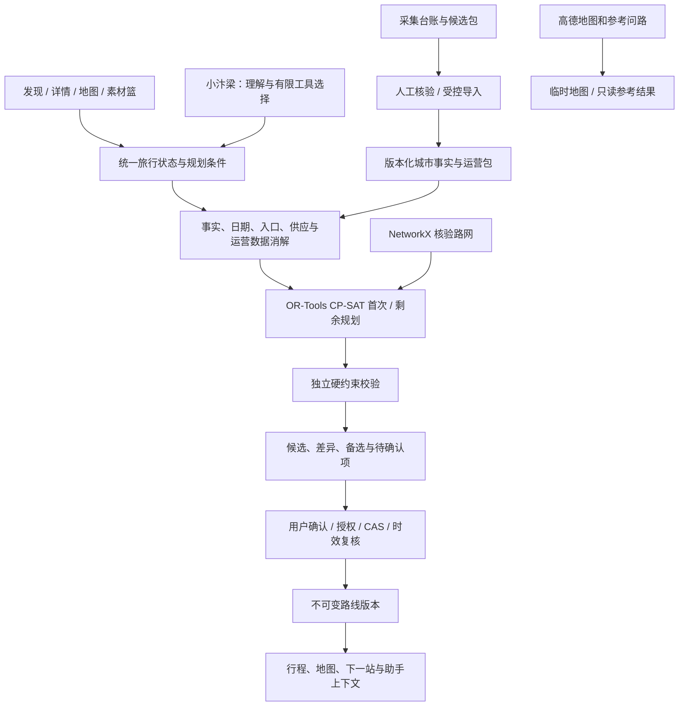

# 汴梁游记项目详细说明

核对日期：2026-10-25。本文是面向使用者、开发者和新成员的工程总览，说明项目是什么、有哪些能力、采用什么技术、如何运行以及当前边界。产品完成条件以 [PRD](PRD.md) 为准，最新完成情况与缺口以 [PROJECT_STATUS](PROJECT_STATUS.md) 为准。

## 1. 项目概述

汴梁游记是一个面向开封自由行的城市旅游 Web 应用原型。它尝试把通常分散在景区导览、演出时间表、地图、餐饮和酒店平台中的信息，组织成一份连续的旅行安排，而不是只生成若干景点推荐。

核心任务是：把游客选择的景点、演出、餐饮、休息、城市交通与返程放进同一份时间预算，计算可衔接的活动顺序；游客中途加餐、休息、跳过或调整后，再从当前地点和进度重新计算剩余行程。

项目以万岁山武侠城、清明上河园为重点示范，但产品模型是城市级行程，不局限于某一个景区。首版面向手机端浏览器，也可以桌面访问；不是原生 App，不包含购票、支付、酒店下单或自建城市导航服务。

### 1.1 解决的主要问题

| 问题 | 项目提供的处理方式 |
| --- | --- |
| 景点、演出和餐厅分散在不同平台 | 使用统一的城市对象、时间窗和旅行工作区组织候选 |
| 推荐顺序忽略演出和营业限制 | 规划时同时核对活动时长、入场截止、营业与转场 |
| 园内安排与城市夜游、返程割裂 | 在同一 `trip` 内管理园内外活动、返程和路线版本 |
| 临时变化后需要从头规划 | 保护已完成记录，从当前有效锚点重算剩余行程 |
| AI 回答可能编造事实或直接改动行程 | 语言模型负责理解和解释，事实、计算、授权与提交由确定性服务负责 |
| 数据不全时仍显示“可执行” | 保留 `unknown`、待确认和 `needs_data`，不将未知耗时、价格或营业状态填零 |

### 1.2 当前交付性质

这是**可运行的本机城市旅游原型**，不是已经完成全城覆盖和现场验收的公共旅游产品。

规划引擎、素材篮、小汴梁助手、行程确认、地图展示及部分外部服务已有软件接线。本机参考资料库可支持参考选点和预览，但 `reference/unverified` 不等于现场核验通过。完整目标日演出、园内可通行路网、营业和供应、正式交通时段依据、真机定位及至少一条真实跨场景路线的途中修改走查，仍是正式 V1 的验收门槛。

## 2. 主要功能

### 2.1 发现、详情与素材篮

- 浏览景区、地点、节目、美食和商家资料，查看图片、介绍、来源与资料状态。
- 景区详情精选主要演出，美食详情区分菜品与实际商家；缺少真实资料时显示待添加。
- 将感兴趣的地点、演出或餐饮加入当前旅程的素材篮，设置优先级和规划条件。
- 素材篮表示“想去”，不等于已经安排；预览也不等于正式路线。

主要页面：`/`、`/scenic/:id`、`/food/:id`、`/place/:id`、`/vendor/:id`、`/basket`。

### 2.2 城市联合规划

- 支持景点、固定日期演出、餐饮、休息、返程及城市交通的联合安排。
- 将地点与活动分开建模，同一地点可以容纳不同场次，不会因 POI 相同而错误去重。
- 核对必选目标、活动持续时间、营业窗口、停止入场、转场、出入园和返程时间。
- 支持必选与可选目标、步行偏好、节奏、预算、固定地点或场次等结构化条件。
- 无可行方案时返回冲突或数据缺口，不静默删除游客的重要目标。

规划输出包括活动顺序、预计到达与离开、等待和停留、逐段交通、时间余量、费用或未知项、证据引用及警告。`feasible` 只表示满足当前模型和资料中的约束，不是现场到达保证。

### 2.3 行程预览、确认与行中调整

- 首次规划和剩余行程调整共用同一个求解器。
- 先产生候选与差异，再由游客确认；确认后生成不可变的新 `route_version`。
- 重规划保护已完成、已跳过、当前活动和锁定目标，不覆盖已执行历史。
- 从最近确认的已知地点与当前时间继续，不以持续 GPS 追踪为前提。
- 确认时复核会话属主、城市版本、路线版本、事实指纹、候选时效和硬约束。
- 并发冲突、候选过期或事务失败时不覆盖上一版有效路线；旧路线失效部分单独标记。

主要页面：`/city-trip/:id?` 查看正式行程和下一站，`/city-trip/manage/:id?` 管理结构化城市草稿。

### 2.4 小汴梁 AI 助手

小汴梁是项目内的单 Agent 旅行助手，支持自然语言条件收集、多轮补充、只读查询、参考问路和有限工具探索。一句话中可以包含有界的解释、查询、旅行服务候选及一个规划提案。

其运行方式不是让模型直接操作数据库：

1. 将文本解析为带原文依据的结构化意图。
2. 服务端检查意图、字段、证据、版本和当前合法动作。
3. 需要探索时，模型只能在白名单工具中选择下一步。
4. 完整方案仍由 OR-Tools 引擎计算，并经独立校验。
5. 自然语言修改只生成预览或待确认意愿，模型没有正式提交工具。

没有配置模型时，确定性页面、表单和已有规划能力仍可使用；语言理解进入有限规则降级，不伪称完整模型能力。主要页面：`/assistant`。

### 2.5 地图、定位与参考路线

- 使用高德 JS API 显示城市底图、业务 Marker 和已确认行程状态。
- 支持明确的临时定位、地图选点、已知地点确认及步行、驾车、公交参考查询。
- 可生成外部高德导航入口；地图展示与正式路线使用同一旅行版本。
- 临时精确位置不写入长期存储或聊天；手动确认的已知地点以 `place_id` 保存。
- 地图 POI 不自动成为已核验入口，参考路线不自动进入正式交通矩阵。
- `/guide?demo=1` 是显式示意入口，示意路网和模拟客流不冒充真实观测。

主要页面：`/guide`。手机浏览器实际定位、录音以及外部 App 往返还需要适合的 HTTPS 环境和真机验证。

### 2.6 天气与旅行服务候选

- 和风天气可在助手加载或主动查询时，检查未来正式行程中可能受影响的活动。
- 天气调整先给出可审查候选，不自动改变正式路线。
- FlyAI 酒店、高德停车场和餐厅 POI 可返回真实服务候选，并保存本次旅行的查询条件和候选意向。
- 酒店展示起价不是多晚、多间房的保证总价；POI 名称不能证明供应、营业、空位或入口路线。
- 候选意向不是正式住宿路线；当前引擎仍是同日城市活动模型，不包含跨日住宿联合求解。

### 2.7 语音输入与游客数据管理

- 全站语音输入通过浏览器录音，将 WAV 发送至后端百炼语音识别适配器。
- 语音只转为可编辑的文字草稿，不自动发送、不自动修改路线。
- `/me`、`/memory` 支持查看当前旅行、导出或删除会话私有资料。
- 采用访客会话与对象授权；没有账号体系、跨设备恢复或长期偏好承诺。

### 2.8 数据采集与独立演出日程

项目包含独立的数据工程，而不是只依赖前端静态资料：

- `collector/` 管理来源发现、采集、证据哈希、质量报告、候选包和人工核验台账。
- 采集数据库与城市事实库分开；候选资料只有经受控导入和显式 `--apply` 才能写入。
- 菜品、商家和供应关系分别建模；节目、舞台和具体日期场次分别建模。
- 独立 PostgreSQL 日程域支持公开节目采集适配、人工审核和按日期查询。
- 未配置 PostgreSQL 时，主应用仍可运行，独立日程能力按缺配置降级。

### 2.9 独立路演页

`/pitch` 是独立的路演展示，包含产品问题、方案、界面、架构、数据边界和路线图。其交互示例是页面内合成内容，不写入游客真实旅行。

## 3. 技术栈

| 层次 | 技术与用途 |
| --- | --- |
| 前端框架 | Vue 3、Vue Router、TypeScript |
| 前端构建 | Vite 7、`vue-tsc` 类型检查 |
| 图标与交互 | `lucide-vue-next`；原生 Web Audio、AudioWorklet、浏览器定位能力 |
| 后端框架 | Python 3.11+、FastAPI、Pydantic、Uvicorn |
| 行程优化 | Google OR-Tools CP-SAT：活动选择、顺序、时间窗和约束优化 |
| 路径计算 | NetworkX：只针对显式提供的核验有向图计算路径 |
| 主数据库 | SQLite：城市事实、草稿、素材篮、会话、候选与路线版本 |
| 独立日程数据库 | PostgreSQL、`psycopg`：独立演出日程采集、审核和发布 |
| 外部接口 | `httpx`：模型、高德、天气、语音等服务端 HTTP 调用 |
| 语言模型 | OpenAI 兼容 JSON 输出协议，可配置 Kimi；不是模型直接执行 SQL |
| 地图与问路 | 高德 JS API 2.0、Web Service；安全码通过受控后端代理使用 |
| 语音识别 | 阿里云百炼 `qwen-audio-3.0-asr-flash` |
| 旅行服务 | FlyAI 官方 CLI 适配器、高德 POI、统一 Provider Registry |
| 数据处理 | pandas、BeautifulSoup、工作簿及采集依赖；用于维护和采集流程 |
| 测试 | pytest、Playwright、TypeScript 构建检查 |
| 部署形态 | 本机模块化单体；生产模式由 FastAPI 同源提供已构建前端 |

项目没有引入多 Agent 框架、LangGraph、向量数据库、RAG、商业求解器或自建城市导航引擎。

## 4. 系统架构与控制权



### 4.1 核心设计：AI 不掌管事实和提交

| 语言模型可以参与 | 确定性服务必须负责 |
| --- | --- |
| 理解自然语言、抽取条件和纠正 | 参数 Schema、原文证据与硬约束保护 |
| 在合法动作中选择下一步工具 | 工具白名单、前置条件、预算、取消和版本检查 |
| 解释候选、差异和缺失信息 | 事实查询、交通矩阵、CP-SAT 与独立校验 |
| 生成待确认的自然语言意愿 | 会话属主、预览时效、幂等、事务和正式提交 |

正式路线提交只有服务端确认门禁。地图参考查询、酒店意向和天气建议都不会绕过该门禁。

### 4.2 状态与事实分层

- **旅行状态**：草稿、素材篮、结构化条件、当前进度、已知地点锚点和路线版本。
- **业务事实**：来源、地点、入口、规则、节目、场次、菜品、商家、供应、交通和费用。
- **临时探索**：模型任务、参考路线和未确认候选，具有独立时效与取消语义。
- **路线版本**：确认后生成；草稿版本与 `route_version` 分离，未确认时为 0。
- **资料等级**：已核验、估计、报告、演示和未知必须可区分；`reference` 仅供参考，不自动升级为现场事实。

## 5. 代码目录

```text
kaifeng-tourism-mvp/
├── backend/
│   ├── app/
│   │   ├── main.py                 # FastAPI 应用、路由注册、同源静态站点
│   │   ├── city/
│   │   │   ├── engine/             # 候选准备、交通、CP-SAT、校验、版本提交
│   │   │   ├── agent/              # 小汴梁语义理解、有限 ReAct 与工具编排
│   │   │   ├── assistant/          # 兼容助手与确认适配
│   │   │   ├── providers/          # 外部能力注册、标准化结果与状态
│   │   │   ├── facts.py            # 城市事实与来源
│   │   │   ├── state.py            # 草稿、进度、锚点与授权状态
│   │   │   ├── basket.py           # 旅程私有素材篮
│   │   │   ├── exploration.py      # 点选、条件和协商规划工作流
│   │   │   ├── travel_services.py  # 酒店、停车、餐饮候选工作区
│   │   │   └── weather.py          # 天气检查和调整候选
│   │   ├── memory/                 # M7 会话、留存、导出和删除台账
│   │   ├── scenic_sync/            # 独立 PostgreSQL 演出日程域
│   │   ├── maps.py                 # 高德配置与受控安全代理
│   │   └── speech.py               # 语音识别适配器
│   ├── tests/                      # 后端、合同、权限、算法和故障测试
│   └── requirements*.lock          # 锁定安装依赖
├── frontend/
│   ├── src/
│   │   ├── pages/                  # 发现、详情、助手、行程、地图、我的等
│   │   ├── components/             # 地图、聊天、规划、媒体、天气和候选卡片
│   │   ├── journey.ts              # 当前旅程的前端共享状态
│   │   ├── cityApi.ts              # 城市状态和事实接口
│   │   ├── cityAgentApi.ts         # Agent 任务接口
│   │   └── explorationApi.ts       # 素材篮和规划接口
│   ├── tests/                      # Playwright 浏览器测试
│   └── pitch/                      # 独立路演构建源文件
├── collector/                      # 来源、采集、质量、候选包与核验工程
├── data/                           # 本地资料、候选证据和运行库，交付时须区分
├── docs/
│   ├── contracts/                  # 城市事实、状态、引擎和 Agent 机器契约
│   ├── reports/                    # 分轮测试、真实调用及问题回执
│   └── reference/                  # 原始产品、架构和数据需求资料
├── scripts/                        # 安装、启动、导入、诊断和验收脚本
├── .env.example                    # 配置模板，不包含真实密钥
└── start.sh / start.cmd            # macOS/Linux 与 Windows 启动入口
```

## 6. 运行方式

### 6.1 环境要求

- Python 3.11 或更高版本。
- Node.js 22.12 或更高版本，包含 npm。
- 首次安装需要联网下载 Python 和 npm 依赖。
- 可选：独立 PostgreSQL，仅用于演出日程同步；主城市行程使用 SQLite。
- 不需要填写任何第三方密钥即可进行基础启动；相应在线能力会降级。

不要从其他电脑复制 `.venv`、`node_modules`、`.env`、私人会话数据库或删除台账。

### 6.2 macOS / Linux 一键运行

在项目根目录执行：

```bash
cd kaifeng-tourism-mvp
./start.sh
```

首次运行会自动创建 `.venv`、安装锁定依赖、执行 `npm ci`、构建前端并初始化本机数据库。后续直接启动，不重复完整安装。

默认访问地址：

| 内容 | 地址 |
| --- | --- |
| 应用 | `http://127.0.0.1:8017` |
| API 文档 | `http://127.0.0.1:8017/docs` |
| 健康检查 | `http://127.0.0.1:8017/api/health` |

按 `Ctrl+C` 停止本次启动器管理的进程。若端口被占用，在自己的 `.env` 修改 `BACKEND_PORT` 或 `FRONTEND_PORT`，启动器不会终止其他项目进程。

### 6.3 Windows 一键运行

在项目根目录打开 PowerShell：

```powershell
py -3 scripts/start.py
```

也可以双击 `start.cmd`。没有 `py` 命令时可使用 `python scripts/start.py`。Windows 依赖解析已有记录，但 Windows 真机运行仍需按实际环境单独验证。

### 6.4 开发热更新

macOS / Linux：

```bash
./start.sh --dev
```

Windows：

```powershell
py -3 scripts/start.py --dev
```

开发模式同时启动后端与 Vite，默认前端地址为 `http://127.0.0.1:5177`，`/api` 代理到后端。生产模式使用 `frontend/dist`；修改前端后需要重新构建，后端普通模式需要正常重启：

```bash
npm run build --prefix frontend
```

### 6.5 分步安装与启动

需要明确执行每个阶段时：

```bash
python3 scripts/setup.py
.venv/bin/python scripts/start.py
```

Windows 对应命令：

```powershell
py -3 scripts/setup.py
.\.venv\Scripts\python.exe scripts\start.py
```

安装脚本检查 Python 和 Node 版本，安装 `backend/requirements.lock`、`backend/requirements-data.lock` 与前端锁定依赖，构建前端并初始化数据库。

### 6.6 可选环境配置

首次配置时从模板复制，已有 `.env` 只补字段，不覆盖：

```bash
cp .env.example .env
```

| 配置组 | 作用 | 未配置时 |
| --- | --- | --- |
| `BACKEND_PORT` / `FRONTEND_PORT` | 后端与开发前端端口 | 默认 8017 / 5177 |
| `DATABASE_PATH` | 可选 SQLite 路径 | 默认 `data/tourism.sqlite3` |
| `TOURISM_LLM_*` | Kimi 等 OpenAI 兼容模型 | 有限规则降级，确定性规划仍可用 |
| `AMAP_JS_*` | 高德浏览器底图和插件 | 地图在线能力不可用 |
| `AMAP_WEB_SERVICE_KEY` | 服务端地点和参考路线查询 | 参考查询不可用，不生成假路线 |
| `AMAP_*_ENABLED` / `AMAP_TERMS_REVIEWED` | 显式启用相应参考能力 | 默认关闭，填 Key 不等于开启 |
| `QWEATHER_*` | 天气和预报 | 天气功能降级 |
| `DASHSCOPE_*` | 百炼语音转文字 | 文字输入仍可用 |
| `FLYAI_*` | FlyAI 酒店候选 | 酒店查询不可用 |
| `SCENIC_SCHEDULE_*` | 独立 PostgreSQL 日程域 | 主应用可运行，日程能力降级 |
| `M7_*` | Cookie、留存和删除台账配置 | 使用本机开发默认值 |

密钥只放本机 `.env` 或服务端环境，不写入 `VITE_*`、前端源码、Git 或交付包。完整字段以 `.env.example` 为准。

### 6.7 启动后核对

修改代码或重启后，先确认端口上的服务确实来自当前目录和代码：

```bash
.venv/bin/python scripts/runtime_status.py
```

Windows：

```powershell
.\.venv\Scripts\python.exe scripts\runtime_status.py
```

`current` 表示运行指纹与磁盘一致；`restart_required` 表示需要正常重启；`unknown` 或 `unavailable` 分别表示旧服务无标识或服务不可达。该命令只读，不杀进程、不改数据。

## 7. 页面与主要接口

### 7.1 页面入口

| 路径 | 用途 |
| --- | --- |
| `/` | 发现景区、美食与城市地点 |
| `/basket` | 当前旅程素材篮和规划入口 |
| `/assistant` | 小汴梁对话、查询、候选和确认 |
| `/city-trip/:id?` | 正式行程、下一站、进度和调整 |
| `/city-trip/manage/:id?` | 结构化城市草稿管理 |
| `/guide` | 地图、临时选点和参考路线 |
| `/me`、`/memory` | 当前旅行、私有资料导出与删除 |
| `/pitch` | 独立路演，不写真实旅行 |

### 7.2 关键后端接口

| 接口组 | 主要职责 |
| --- | --- |
| `/api/health` | 数据库和运行指纹健康检查 |
| `/api/city/v1/trips` | 城市旅行、草稿、进度、事实和对象授权 |
| `/api/city/v1/trips/{trip_id}/basket` | 素材篮读取和修改 |
| `/api/city/v1/trips/{trip_id}/engine` | 规划预览、剩余重规划、确认、当前和历史版本 |
| `/api/city/v1/trips/{trip_id}/agent` | 理解、分步任务、取消和能力状态 |
| `/api/city/v1/trips/{trip_id}/services` | 酒店、停车和餐饮候选工作区 |
| `/api/maps` | 地图配置和固定官方上游代理 |
| `/api/speech` | 语音可用状态与转写 |
| `/api/v1` | 会话、留存、导出和删除等 M7 能力 |
| `/api/scenics` | 兼容的旧单景区资料接口 |

实际请求字段以 FastAPI `/docs` 和 `docs/contracts/` 为准，不要根据历史报告猜测契约。

## 8. 测试与演示

### 8.1 标准本地检查

完成安装后，在项目根目录运行：

```bash
./scripts/check.sh
```

该命令执行后端 pytest、前端 TypeScript 检查和 Vite 生产构建。

完整浏览器回归：

```bash
npm run test:e2e --prefix frontend
```

首次使用 Playwright 时，在 `frontend/` 下安装 Chromium：

```bash
npx playwright install chromium
```

采集工程测试：

```bash
.venv/bin/python -m pytest -q collector/tests
```

机器契约检查：

```bash
.venv/bin/python scripts/export_engine_contracts.py --check
.venv/bin/python scripts/export_agent_contracts.py --check
.venv/bin/python scripts/export_city_assistant_contracts.py --check
```

默认浏览器测试使用隔离临时库和合成资料，不写入本机旅游数据库。PostgreSQL 用例只在配置独立的 `SCENIC_TEST_DATABASE_URL` 后执行，不能使用业务库连接。真实模型、地图和旅行服务测试必须显式启用，可能产生配额或费用；不要为普通本地回归开启。

### 8.2 无网络规划演示

已安装依赖时，可运行完全使用合成资料的引擎演示：

```bash
.venv/bin/python scripts/demo_city_engine.py
```

该演示不依赖 AI、数据库或网络，只证明明确标注的合成约束计算，不代表真实开封路线通过。

### 8.3 验证结果如何理解

- 软件测试证明对应代码在指定夹具、Mock 或隔离库中的行为。
- 外部接口成功只证明当次请求和字段适配，不证明完整业务闭环。
- 真实路线需要目标日事实、正式交通依据和现场走查。
- 游客体验改善需要与官方导览、普通地图和餐饮平台进行同任务对照，不能由求解分数或模拟数据代替。
- 不同日期的测试数量、数据库计数和运行端口是快照，不能跨轮相加或直接当作最新结果。

## 9. 功能亮点

### 9.1 连续行程，而非推荐列表

把“看什么、吃什么、何时转场、如何返程”放入同一优化问题。演出不是页面上的附属信息，餐饮也不是一张卡片，而是会消耗时间并影响后续衔接的活动。

### 9.2 可解释的约束规划

采用 CP-SAT 处理必选目标、时间窗、顺序、交通和预算，再由独立校验器复核。结果能指出未满足目标、缺口和受影响对象；与只依赖语言模型生成路线相比，更容易复现、测试和定位冲突。

### 9.3 预览与正式状态彻底分离

素材篮、酒店意向、天气建议、自然语言意愿和引擎预览都不是正式路线。只有确认接口在版本和证据复核通过后才生成新版本，减少误操作和对话式修改带来的状态混乱。

### 9.4 行中修改保留历史

重规划不是清空后重新开始。它保护已执行前缀、当前活动和锁定目标，以当前有效锚点继续计算，适合加餐、休息、跳过和临时调整等实际旅行任务。

### 9.5 数据不足可以诚实降级

项目把“不知道”作为明确状态。没有场次结束时间、入口、供应证据、营业信息或交通依据时，系统返回待确认或数据缺口，而不是用零耗时、免费、默认开放或直线距离补齐。

### 9.6 外部服务可替换且不侵入核心引擎

Provider Registry 统一描述能力、标准化结果、授权状态和调用轨迹。地图、酒店、天气等外部服务可独立降级；核心行程状态、确认和算法不依赖某一家模型供应商。

### 9.7 从展示到数据治理的一体化原型

项目同时包含移动端界面、助手、优化算法、版本化状态、采集与导入工具、机器契约、隔离测试和现场核验清单，适合作为城市旅游连续行程方向的工程与研究验证基础。

## 10. 当前边界与后续重点

当前不应将以下能力视为已经完成：

- 全城真实地点覆盖、精确园内导航或实时交通保证。
- 完整目标日场次、当日营业和商家供应已核验。
- 真实跨场景路线与一次途中修改的现场验收。
- 跨日住宿联合求解、真实下单、支付、票务或订单同步。
- 持续 GPS 追踪、后台推送、实时客流、精确避堵或排队预测。
- 多实例全局限流、跨进程 Agent 任务恢复、账号和跨设备身份恢复。
- 游客效率、满意度或节省时间的效果结论。

后续优先级是：先完成有限真实地点链的证据和受控导入，再进行真实路线与途中修改走查；同时继续收口助手知识问答、输出复核、真机兼容性、复杂任务延迟和游客对照实验。详细清单见 [PROJECT_STATUS](PROJECT_STATUS.md) 和 [REAL_ROUTE_FIELD_CHECKLIST](REAL_ROUTE_FIELD_CHECKLIST.md)。

## 11. 延伸阅读

- [产品需求基准](PRD.md)：V1 范围、输入输出、交互和完成条件。
- [开发方向](DEVELOPMENT_DIRECTION.md)：产品来源、决策取舍和 V01–V18 验收矩阵。
- [当前工程架构](CITY_ARCHITECTURE.md)：实际模块连接和控制权。
- [规划引擎](PLANNING_ENGINE_V1.md)：CP-SAT、交通、预览确认和重规划细节。
- [小汴梁 V3](CITY_AGENT_V3.md)：语义理解、有限 ReAct、任务预算与隐私。
- [城市存储与事实](CITY_STORAGE_AND_FACTS.md)：数据模型、事实准入和导入。
- [地图与定位](AMAP_MAP_LOCATION_MVP.md)：地图代理、位置语义和参考路线。
- [Windows 团队接手](../HANDOFF.md)：新机器安装、配置和交接步骤。
- [项目现状](PROJECT_STATUS.md)：分轮结果、已知失败和最新业务边界。
