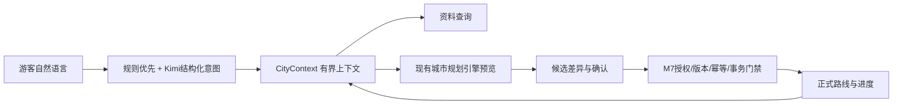

# 小汴梁 V2 城市行程上下文与连续旅行助手

> 历史阶段记录：仅描述原日期的软件、操作与验收边界，不作为当前开发待办或最新完成声明。当前状态见 [PROJECT_STATUS](../../PROJECT_STATUS.md)。

后续增量：V3 已复用本页后端能力，并新增受控探索及城市助手前端接线，见 [CITY_AGENT_V3.md](../../CITY_AGENT_V3.md)。本页的前端未实施等表述是 V2 交付时点记录。

更新时间：2026-10-21。本文记录 V2 后端城市助手的实际实现边界、接口和验证结果。它是后端交付说明，不把合成数据或模型联调写成真实开封业务验收。

## 交付结论

V2 已在现有 FastAPI、SQLite、M7 会话和城市规划引擎上增加一个可独立接入的城市助手层。它能够从正式城市行程、路线版本、活动进度、手动位置和待确认候选构造有界上下文，处理连续多轮查询和修改意图，并把重规划交给现有确定性引擎。正式路线仍只有在候选确认、版本校验和事务提交成功后才改变。

本轮没有修改前端源码，也没有重启正在运行的 8017 服务。前端保护指纹中 `frontend/src/journey.css` 与 `frontend/src/pages/JourneyPage.vue` 已有并行编辑产生的差异，保留原样。新 API 需要后端按项目既有方式正常重启后才会在运行进程中加载。

## 根因与职责边界

旧 `memory/context.py` 只读取旧 `trip_states`、旧 `plans` 和 scenic facts，无法看到 `city_trip_states`、`city_engine_routes` 或城市候选，因此助手会把草稿、聊天摘要和正式路线混在一起。V2 使用 `backend/app/city/assistant/context.py` 作为城市上下文入口，正式城市状态和路线由服务端重新读取；聊天消息和摘要只能作为有限的对话辅助，不能成为正式约束来源。

职责分层如下：



- LLM 只负责提取本轮意图和组织解释；不能输出所有者、SQL、工具权限、事实核验状态或正式版本。
- `city.engine.service`、`city.state` 和 `city.facts` 负责路线、硬约束、事实和状态写入。
- M7 负责会话授权、对象属主、版本冲突、幂等、留存、导出和删除边界。
- 长期画像始终关闭；“少走路”等偏好只属于当前旅行，需确认后保存。

## 上下文结构与按需读取

`CityContext` 的契约版本为 `city-context/2`，包括：当前会话授权、trip/version/route_version、正式路线状态、活动顺序、完成/跳过/进行中/剩余活动、下一站、手动位置、待确认候选、最近 8 条同旅行消息、最多 600 字摘要、按目的裁剪的事实和上下文限制。

读取目的由 `purpose` 控制：

- `next` 只返回正式路线和进度，不加载商家、演出目录或旧对话。
- `dining` 加载当前行程相关餐饮地点及当日营业规则。
- `shows` 加载当前相关演出场次。
- `travel` 只使用当前位置到下一站的已核验交通依据；缺数据返回 `needs_data`，不会填零分钟。
- `modify`/`history` 才加载完成修改或恢复所需的候选和事实。

上下文上限为 12000 字符；不含原始坐标、完整道路几何、GPS 轨迹、token 或无关城市目录。手动位置标为 `user_reported`，`live_tracking=false`，过期位置不能驱动重规划。

## 连续对话与候选确认

助手支持下一站、演出时间、餐饮营业、交通估时、进度报告、位置报告、偏好变化、提前用餐、保留演出、历史版本恢复和取消修改。规则先识别高风险操作；需要开放式结构化提取时才调用 Kimi，并用 Pydantic `Intent` 严格校验。

典型流程是：

1. “我想先吃饭”只保存本次旅行的未确认意愿，正式路线不变。
2. “下午的演出别动”合并到同一未确认意愿。
3. “帮我调整一下”调用现有引擎生成候选，返回受影响活动、时间和路线差异。
4. 用户确认后才提交新路线；用户说“不改了”则消费候选并保持正式路线不变。

已完成活动前缀会被保护；完成报告缺少实际开始时间时要求补充，不能用计划时间冒充实际记录。已结束旅行只读，需新建旅行。

## API

新增路由：

| 方法 | 路径 | 用途 |
| --- | --- | --- |
| GET | `/api/city/v1/assistant/current-context` | 读取当前城市旅行上下文 |
| POST | `/api/city/v1/trips/{trip_id}/activate` | 显式切换当前城市旅行 |
| GET | `/api/city/v1/trips/{trip_id}/assistant/context` | 按 purpose 读取指定旅行上下文 |
| POST | `/api/city/v1/trips/{trip_id}/assistant/chat` | 连续对话、查询或生成候选 |
| POST | `/api/city/v1/trips/{trip_id}/assistant/confirm` | 确认 route/state 候选 |
| POST | `/api/city/v1/trips/{trip_id}/assistant/cancel` | 丢弃待确认候选 |

旧 `/api/v1/chat` 增加可选 `trip_scope`；默认 `scenic` 保持兼容，`city` 才进入城市助手。城市助手不会把旧单景区 trip 自动混入城市上下文。

机器契约由 `scripts/export_city_assistant_contracts.py` 生成到 `docs/contracts/city-assistant-v2.schema.json`，可用 `--check` 检查是否与 Pydantic 源模型一致。

## 复用模块与新增文件

新增城市助手模块：

- `backend/app/city/assistant/models.py`：聊天、意图、上下文、确认和取消模型。
- `backend/app/city/assistant/context.py`：正式状态优先的上下文组装和 purpose 裁剪。
- `backend/app/city/assistant/interpret.py`：规则优先、Kimi 结构化意图解析和指代消歧。
- `backend/app/city/assistant/tools.py`：对现有规划、状态和候选接口的受控适配。
- `backend/app/city/assistant/service.py`：读上下文、解析、查询、预览、确认前等待的协调器。
- `backend/app/city/assistant/api.py`：HTTP 路由。

复用 M7 会话/授权/留存/删除台账、`city.state`、`city.facts`、`city.engine.service` 和 Kimi `language._call`。没有复制 HTS-RPR 研究实现，没有引入新的路线求解器、向量库、RAG 或多 Agent。

## 数据真实性与降级

当前评测使用一次性合成数据库，`real_kaifeng_data_validated=false`。运行库中的真实城市地点、道路、演出、商家、交通和客流资料仍需后续核验和导入。Kimi 已完成 API 可用性和结构化提取联调，但这不等于真实游客多轮准确率验证。

缺少事实、交通覆盖、有效营业规则或可行路线时，接口返回 `needs_data`、`infeasible` 或 `unavailable`，保留上一次正式路线；不会将未知拥挤或未知道路当作低拥挤或畅通。工具失败、版本冲突、候选过期和事务失败均不会写半份正式状态。

## 验证命令与结果

在项目目录执行：

```bash
.venv/bin/pytest -q backend/tests/test_city_assistant.py
# 35 passed, 1 warning

.venv/bin/pytest -q
# 331 passed, 1 warning

.venv/bin/python scripts/export_city_assistant_contracts.py
.venv/bin/python scripts/export_city_assistant_contracts.py --check
# City assistant contracts match source

.venv/bin/python scripts/evaluate_city_assistant.py \
  --output docs/reports/city-assistant-offline-20261021.json
# status=passed; synthetic fixture; formal_mutations_without_confirmation=0
```

专项测试覆盖路线读取、进度、演出和餐饮查询、交通缺数据、候选确认/取消、版本冲突、权限、留存关闭、多旅行隔离、Kimi 越权字段、上下文裁剪和回滚。离线评测固定执行“下一站 → 先吃饭 → 保留演出 → 调整 → 放弃”五轮，状态读取错误率为 0，错误工具调用率为 0，未确认正式变更为 0。

真实 Kimi 多轮评测可选执行，最多 6 次请求且只发送合成 fixture：

```bash
.venv/bin/python scripts/evaluate_city_assistant.py --live \
  --output docs/reports/city-assistant-live-20261021.json
```

## 尚未完成

- 前端尚未接入上述城市助手 API；接线时应复用当前城市行程状态，不改变页面布局合同。
- 真实开封城市事实、园内核验道路、商家营业、演出场次和交通服务仍需来源、日期、版本和现场/运营核验。
- 高德真实 Key、权限、配额、联网超时和生产错误预算尚未验收；当前仅保留适配代码和替身测试。
- 没有真实游客样本，因此没有模型准确率、路线体验改善或生产 SLA 结论。
- 运行服务尚未重启；完成前端编辑后按既有启动方式重启后端，再做接口走查。

